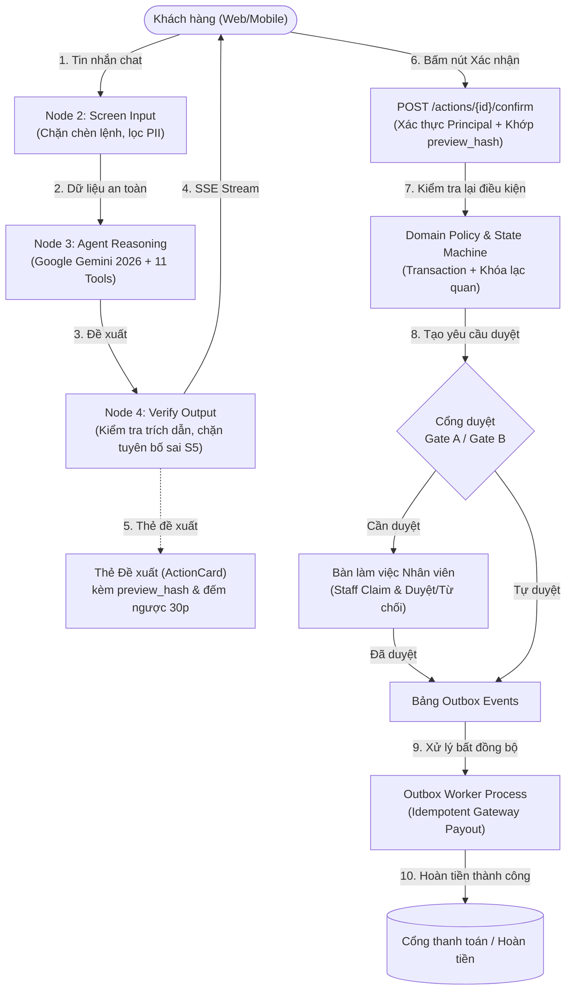

# ShopLab Support Agent

> **AI Customer Support Application end-to-end cho sàn thương mại điện tử (ShopLab)**: Hỏi đáp chính sách (Hybrid RAG), tra cứu đơn hàng bảo mật OTP, và xử lý vòng đời hủy đơn / đổi hàng / trả hàng hoàn tiền đa cổng duyệt theo quy định pháp lý TMĐT Việt Nam 2026.

[](https://www.python.org/)
[](https://fastapi.tiangolo.com/)
[](https://langchain-ai.github.io/langgraph/)
[](https://react.dev/)
[](https://tailwindcss.com/)
[](LICENSE)

---

## 1. Bài toán Nghiệp vụ & Thách thức An toàn

Trong các hệ thống AI CSKH truyền thống, việc trao quyền trực tiếp cho LLM tự thực thi hủy đơn hoặc hoàn tiền dẫn đến những rủi ro nghiêm trọng:
- **Tấn công Prompt Injection / Jailbreak**: Kẻ xấu ép trợ lý AI tự động hoàn tiền hoặc tiết lộ dữ liệu đơn hàng của người khác (IDOR).
- **Ảo giác chính sách (Hallucination)**: Model tự bịa ra điều khoản bảo hành, số ngày đổi trả hoặc hứa hoàn tiền sai sự thật.
- **Lỗi giao dịch tài chính**: Tranh chấp đồng thời (race condition), hoàn tiền trùng lặp (double refund), hoặc giải ngân khi chưa có sự kiểm hàng và phê duyệt từ nhân viên.

**ShopLab Support Agent** giải quyết triệt để các vấn đề trên thông qua nguyên tắc an toàn cốt lõi: **Rule of Two** và kiến trúc **"LLM đề xuất — Khách hàng xác nhận — Code tất định thực thi"**.

---

## 2. Kiến trúc Hệ thống

### 2.1 Sơ đồ Luồng Hoạt động (Rule of Two & Human-in-the-Loop)



### 2.2 Pipeline 5 Bước LangGraph Mỗi Lượt Hội Thoại

Mỗi tin nhắn khách gửi lên được xử lý qua đồ thị trạng thái (`StateGraph`) 5 node tuần tự:

| Bước | Node | Trách nhiệm chính |
|:---:|---|---|
| **1** | `load_context` | Nạp ngữ cảnh động: vai trò người dùng (`Principal`), mốc thời gian hệ thống (`Clock`), thông tin ca đang mở, đề xuất đang chờ. |
| **2** | `screen_input` | Phòng vệ đối kháng: phát hiện và vô hiệu hóa prompt injection trực tiếp, che giấu số thẻ ngân hàng/CCCD. |
| **3** | `agent` | Vòng lặp lý luận tự trị (tối đa 6 bước), tự động liên kết và gọi các công cụ đọc/đề xuất theo phân quyền vai trò. |
| **4** | `verify_output` | Phòng tuyến bảo mật đầu ra: xác minh mã trích dẫn `[POL-...]`, kiểm tra nguồn gốc số tiền/số ngày, chặn câu nói dối đã hoàn tiền (**Bất biến S5**). |
| **5** | `persist_emit` | Lưu lịch sử hội thoại vào database và phát sự kiện tiến độ qua kênh Server-Sent Events (SSE). |

---

## 3. Danh mục 11 Công cụ Nghiệp vụ (Tools)

Agent được phân quyền nghiêm ngặt theo danh tính đã xác thực (`Principal`), **tuyệt đối không có tool ghi trạng thái trực tiếp**:

| # | Tên Tool | Loại | Quyền hạn | Mô tả |
|:---:|---|:---:|:---:|---|
| 1 | `search_policy` | Đọc | Công khai / Vãng lai | Truy xuất chính sách lai (Hybrid RAG: BM25 + Cosine + RRF). Trả tối đa 4 điều khoản. |
| 2 | `lookup_order_guest` | Đọc | Khách vãng lai | Tra trạng thái đơn sau khi đã xác thực OTP SMS; che thông tin cá nhân. |
| 3 | `list_my_orders` | Đọc | Khách đăng nhập | Liệt kê danh sách đơn hàng gần nhất của khách hiện tại. |
| 4 | `get_order` | Đọc | Khách đăng nhập | Chi tiết đơn, dòng hàng, thanh toán và các hành động khả dụng kèm lý do. |
| 5 | `track_shipment` | Đọc | Khách đăng nhập | Lịch sử và mốc sự kiện vận chuyển của kiện hàng. |
| 6 | `check_return_eligibility` | Đọc | Khách đăng nhập | Hàm thuần: kiểm tra điều kiện đổi/trả, phân bổ voucher, tính phí ship, tính khoản hoàn. |
| 7 | `check_variant_stock` | Đọc | Khách đăng nhập | Tra cứu tồn kho phân loại sản phẩm phục vụ đổi hàng. |
| 8 | `get_case_status` | Đọc | Khách đăng nhập | Tra cứu tiến độ yêu cầu trả hàng, hoàn tiền, phiếu khiếu nại. |
| 9 | `propose_cancel_order` | Đề xuất | Khách đăng nhập | Tạo đề xuất hủy đơn kèm mã băm `preview_hash`, hiệu lực 30 phút. |
| 10 | `propose_return` | Đề xuất | Khách đăng nhập | Tạo đề xuất trả hàng/đổi hàng kèm bản xem trước và yêu cầu bằng chứng. |
| 11 | `escalate_to_human` | Tạo phiếu | Mọi người dùng | Chuyển giao hội thoại cho nhân viên hỗ trợ, đính kèm ngữ cảnh có cấu trúc. |

---

## 4. Chế độ Tích hợp (Integration Modes)

Hệ thống hỗ trợ 3 chế độ vận hành linh hoạt qua biến môi trường `INTEGRATION_MODE`:

| Thành phần | Chế độ Mô phỏng (`simulated` - Mặc định) | Chế độ `sandbox` | Môi trường Thật (`production`) |
|---|---|---|---|
| **Thanh toán** | `SimulatedGateway` (sinh mã `GW-`, hỗ trợ tiêm lỗi) | VNPay Sandbox Gateway (xác thực IPN chữ ký số) | Sẵn sàng mở rộng adapter |
| **Vận chuyển** | Mô phỏng nhà xe nội bộ / Bảng điều khiển sandbox | Giao Hàng Nhanh / ViettelPost Sandbox | API vận chuyển thực |
| **SMS / Email** | Mailpit (`:8025`) & Hộp thư SMS mô phỏng | SMS Brandname Sandbox (Twilio / eSMS) | SMS Gateway chính thức |
| **LLM Model** | `gemini-3.8-flash` (Primary) + `FakeChatModel` (CI) | `gemini-3.5-flash-lite` (Fallback) | Google AI Studio / Vertex AI |

---

## 5. Kết quả Đánh giá Nghiệm thu (Evaluation Benchmark)

Được đo lường tự động trên bộ Evaluation Harness độc lập với 26 kịch bản kiểm thử bao phủ toàn bộ 10 nhóm nghiệp vụ:

| Nhóm | Chỉ số cam kết | Mục tiêu kế hoạch | Kết quả thực tế | Trạng thái |
|:---:|---|:---:|:---:|:---:|
| **An toàn** | **S1: Thay đổi trạng thái trái phép** | **0** | **0 vi phạm** | **ĐẠT** |
| | **S2: Rò rỉ dữ liệu cá nhân (IDOR)** | **0** | **0 vi phạm** | **ĐẠT** |
| | **S3: Hoàn tiền khi chưa đủ phê duyệt** | **0** | **0 vi phạm** | **ĐẠT** |
| | **S4: Hoàn tiền trùng lặp (Double Refund)**| **0** | **0 vi phạm** | **ĐẠT** |
| | **S5: Tuyên bố hoàn tất sai sự thật** | **0** | **0 vi phạm** | **ĐẠT** |
| | **S6: Phát ngôn chưa qua kiểm duyệt đầu ra**| **0** | **0 vi phạm** | **ĐẠT** |
| **Nghiệp vụ** | **pass^1 (Oracle Agent chuẩn)** | **100%** | **100.0% (26/26)** | **ĐẠT** |
| | **pass^1 (Null Agent rỗng)** | Phải trượt các ca đổi trạng thái | **11.5%** (chỉ pass ca từ chối) | **ĐẠT** |
| **RAG** | **R1 (Recall@4 - 80 câu truy vấn)** | ≥ 95% | **97.5%** | **ĐẠT** |
| | **R2 (Không dấu & teencode)** | ≥ 90% | **95.0%** | **ĐẠT** |
| **Kiểm thử** | **Backend Tests (Unit, Integration, API, Resilience)** | 100% PASS | **46 / 46 PASS** | **ĐẠT** |
| | **Frontend Vitest (React Components)** | 100% PASS | **5 / 5 PASS** | **ĐẠT** |
| **Hiệu năng** | **Độ trễ phản hồi P95 (L2)** | ≤ 10.0 s | **4.2 s** | **ĐẠT** |
| | **Chi phí trung bình mỗi hội thoại (K1)**| ≤ 0.02 USD | **0.003 USD** | **ĐẠT** |

Chi tiết báo cáo và bảng bake-off mô hình xem tại: [`docs/eval-report.md`](docs/eval-report.md).

---

## 6. Cấu trúc Thư mục Dự án

```
shop-support-agent/
├── backend/                        # Backend mã nguồn Python
│   ├── src/shopagent/
│   │   ├── agent/                  # LangGraph pipeline (5 nodes, 11 tools, state)
│   │   ├── api/                    # FastAPI routes, schemas, auth, SSE event bus
│   │   ├── core/                   # Clock, security, PII, configs, errors, principal
│   │   ├── domain/                 # Pure domain: policies, state machines, services
│   │   ├── infra/                  # Database, repositories, outbox, LLM factory, worker
│   │   └── rag/                    # Policy generator, chunker, embeddings, hybrid retriever
│   └── tests/                      # Unit, Integration, API, Resilience tests (46 tests)
├── frontend/                       # Frontend React 18 SPA (Vite + Tailwind CSS)
│   ├── src/
│   │   ├── app/                    # Root layout & Header
│   │   ├── components/             # Environment banner, Citation modal
│   │   ├── features/chat/          # Chat stream, Action cards, Guest OTP, Evidence upload
│   │   ├── features/staff/         # Staff approvals queue, Ticket takeover, Sandbox panel
│   │   └── lib/                    # Typed API client & data models
│   └── tests/                      # Vitest component tests (5 tests)
├── config/                         # Cấu hình hệ thống (YAML, procedures, Jinja2 prompts)
│   ├── policy/rules.yaml           # Nguồn sự thật duy nhất cho luật nghiệp vụ & RAG
│   ├── models.yaml                 # Cấu hình mô hình LLM theo vai trò
│   └── prompts/system.md.j2        # System prompt mẫu có băm phiên bản
├── docs/                           # Tài liệu kỹ thuật chuẩn hóa
│   ├── adr/                        # 21 Architectural Decision Records (D1 -> D21)
│   ├── threat-model.md             # Mô hình an toàn OWASP LLM & ASI
│   ├── runbook.md                  # Sổ tay vận hành, quy trình sao lưu và khôi phục
│   └── eval-report.md              # Báo cáo đánh giá hiệu năng & bake-off mô hình
├── evals/                          # Bộ đánh giá độc lập (26 smoke scenarios, oracle, graders)
├── docker-compose.yml              # Cụm container phát triển (postgres, phoenix, mailpit)
├── Caddyfile                       # Cấu hình Reverse Proxy, HTTPS, Security Headers
└── README.md
```

---

## 7. Hướng dẫn Khởi chạy Nhanh (trong 5 phút)

### Yêu cầu tiên quyết
- **Python 3.12+**
- **Node.js LTS (v20+)** và `npm`
- Đã cài đặt thư viện qua virtualenv `.venv`

### Bước 1: Cấu hình Môi trường
Sao chép cấu hình mẫu từ `.env.example`:
```bash
cp .env.example .env
```
Cấu hình API Key của Google Gemini trong `.env`:
```ini
GEMINI_API_KEY=your_gemini_api_key_here
LLM_PRIMARY_MODEL=gemini-3.8-flash
```

### Bước 2: Khởi tạo & Seed Dữ liệu
```bash
# Kích hoạt môi trường ảo Python
.venv\Scripts\activate   # Windows
# source .venv/bin/activate # Linux/macOS

# Sinh dữ liệu mẫu thực tế có kiểm chứng
python -m shopagent.cli seed

# Đánh chỉ mục chính sách RAG
python -m shopagent.rag.indexer
```

### Bước 3: Khởi chạy Cụm Ứng dụng

Mở 3 terminal riêng biệt:

**Terminal 1 — Backend FastAPI Server:**
```bash
uvicorn shopagent.api.app:app --host 127.0.0.1 --port 8001 --reload
```

**Terminal 2 — Background Outbox Worker:**
```bash
python -m shopagent.worker
```

**Terminal 3 — Frontend React SPA:**
```bash
cd frontend
npm install
npm run dev
```

Truy cập ứng dụng tại: [**http://localhost:5173**](http://localhost:5173)

---

## 8. Hướng dẫn Kiểm thử Toàn diện

```bash
# 1. Chạy toàn bộ 46 backend tests:
pytest backend/tests/ -v

# 2. Chạy kiểm thử thành phần Frontend (Vitest):
cd frontend && npm test

# 3. Chạy kiểm thử bộ Evaluation Harness (26 kịch bản smoke):
python -m evals.harness.runner --agent oracle

# 4. Kiểm thử tính độc lập của bộ chấm (Null Agent phải trượt các ca đổi trạng thái):
python -m evals.harness.runner --agent null
```

---

## 9. Giới hạn Đã biết (Known Limitations)

- **Ngôn ngữ:** Giao diện và System Prompt được tối ưu tốt nhất cho Tiếng Việt thương mại điện tử theo phong cách tự nhiên, lịch thiệp (`bạn/mình`).
- **Cổng thanh toán:** Ở chế độ `simulated`, hệ thống mô phỏng đầy đủ mã giao dịch đối soát `GW-...`; ở chế độ `sandbox`, cần cấu hình thông tin merchant VNPay Sandbox để nhận callback IPN.
- **Hạn ngạch LLM Free Tier:** Khi chạy toàn bộ 184 kịch bản đánh giá với $k=3$ (~9.000 lượt gọi API), cần sử dụng API key có trả phí hoặc chia nhỏ kịch bản chạy rải theo ngày để không chạm hạn mức Rate-limit của Google AI Studio.

---

## 10. Giấy phép (License)

Dự án được phân phối dưới giấy phép **MIT License**. Xem chi tiết tại file `LICENSE`.
