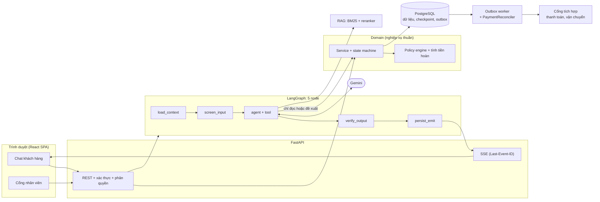
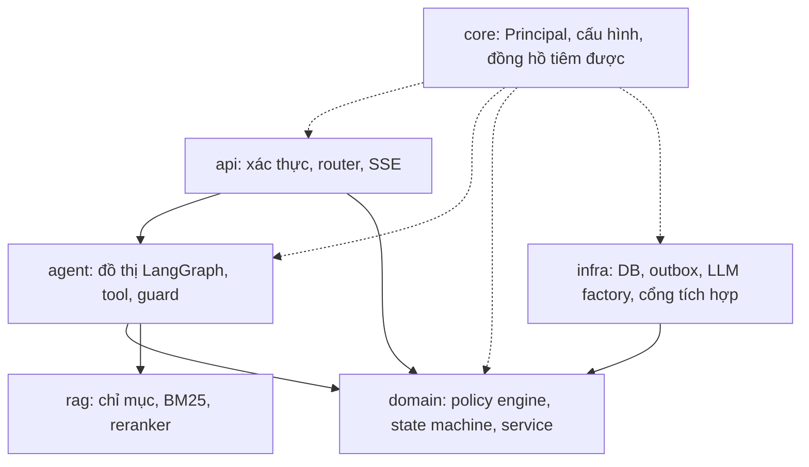

# ShopSupport AI

Trợ lý chăm sóc khách hàng cho sàn thương mại điện tử: trả lời chính sách bằng RAG, tra cứu đơn hàng theo quyền, và xử lý hủy đơn, đổi hàng, trả hàng hoàn tiền theo quy định thương mại điện tử Việt Nam.

Nguyên tắc cốt lõi: **LLM đề xuất, khách hàng xác nhận, hệ thống thực thi.** LLM không có quyền ghi vào cơ sở dữ liệu.

## Giao diện


Khách yêu cầu trả hàng, trợ lý chỉ tạo thẻ đề xuất có hạn xác nhận; hành động chỉ chạy sau khi khách bấm **Xác nhận** và nhân viên duyệt. Ảnh chụp từ giao diện thật với API giả lập ([cách chụp lại](#chụp-lại-ảnh-giao-diện)). Cổng nhân viên ở `/staff`.

## Kiến trúc

Ba ràng buộc quyết định toàn bộ thiết kế:

1. **LLM không có quyền ghi.** Tool `propose_*` chỉ tạo `ActionProposal` kèm `preview_hash` và hạn xác nhận (`pending_action_ttl_minutes` trong `config/policy/rules.yaml`, hiện 30 phút). Hành động chỉ chạy khi khách gọi `POST /actions/{id}/confirm`; domain service kiểm tra lại điều kiện và tính tiền hoàn bằng code.
2. **Người duyệt theo mức rủi ro.** Hoàn trên 500.000 đ cần nhân viên, trên 2.000.000 đ hoặc có cờ rủi ro cần trưởng ca. Người kiểm hàng không được tự duyệt khoản hoàn mình vừa lập (four-eyes).
3. **Văn bản của trợ lý chỉ đến khách sau khi được kiểm chứng.** Trích dẫn, số liệu và tuyên bố "đã hoàn tất" phải khớp kết quả tool thành công.

### Tổng quan hệ thống



### Phụ thuộc giữa các tầng



`domain/` không phụ thuộc framework LLM; `infra/` cài đặt các cổng mà domain định nghĩa. Tool trong `agent/` chỉ đọc hoặc tạo đề xuất.

### Vòng đời một hành động ghi

```mermaid
sequenceDiagram
    autonumber
    actor K as Khách hàng
    participant A as Agent (LLM)
    participant S as Domain service
    participant DB as PostgreSQL
    participant W as Worker
    actor N as Nhân viên

    K->>A: "Tôi muốn trả hàng SL-..."
    A->>S: propose_return (chỉ tạo đề xuất)
    S->>DB: PendingAction + preview_hash + hạn
    A-->>K: ActionCard (chưa có gì bị thay đổi)
    K->>S: POST /actions/{id}/confirm (preview_hash)
    S->>S: kiểm tra lại điều kiện, tính tiền bằng code
    alt cần duyệt (cổng A hoặc B)
        S->>DB: ApprovalRequest
        N->>S: /staff/approvals/{id}/decision (bắt buộc ghi chú)
    end
    S->>DB: đổi trạng thái + outbox_events (cùng một giao dịch)
    DB-->>W: sự kiện outbox
    W->>W: giải ngân; PaymentReconciler đối soát khoản kẹt
```

Số thứ tự tin nhắn và sự kiện SSE cấp phát nguyên tử bằng khóa bi quan trên PostgreSQL; client gửi `X-Idempotency-Key` để khử trùng lặp, kết nối lại bằng `Last-Event-ID`.

### Một lượt hội thoại

1. `load_context`: nạp `Principal`, đồng hồ hệ thống, đề xuất đang chờ.
2. `screen_input`: chặn prompt injection, che PII.
3. `agent`: Gemini gọi tool. Vòng lặp có giới hạn số bước, số lần gọi tool và thời gian. Các guard xác định chạy ngoài LLM: `tool_requirements` (tool bắt buộc, nhắc tối đa 2 lần rồi trả `requirements_unmet`), `slot_guard` (tham số phải có nguồn), `proposal_guard` (không đề xuất trùng), `grounding`.
4. `verify_output`: đối chiếu trích dẫn `[POL-...]`, số liệu và tuyên bố hoàn tất với kết quả tool thành công.
5. `persist_emit`: lưu tin nhắn và phát sự kiện SSE.

Trạng thái lượt: `completed`, `synthesized`, `requirements_unmet`, `degraded`. Quyết định thiết kế chi tiết ở [docs/adr/](docs/adr/), riêng điều khiển lượt ở [ADR 022](docs/adr/022-D22-agent-turn-control.md); mô tả cấu trúc đầy đủ ở [docs/architecture.md](docs/architecture.md).

### Tìm kiếm chính sách

BM25 trên điều khoản chính sách, chuẩn hóa câu hỏi (viết tắt, số tiền), khôi phục dấu tiếng Việt, rồi tùy chọn xếp hạng lại bằng cross-encoder `BAAI/bge-reranker-v2-m3-int8`. Câu hỏi có điểm dưới ngưỡng `retrieval.reranker.min_score` trong [config/app.yaml](config/app.yaml) bị từ chối thay vì trả điều khoản gần đúng.

## 11 công cụ nghiệp vụ

| Tool | Quyền | Mô tả |
|---|---|---|
| `search_policy` | Công khai | Tra cứu điều khoản chính sách |
| `lookup_order_guest` | Khách vãng lai | Tra cứu đơn sau khi xác thực OTP |
| `list_my_orders` | Đăng nhập | Danh sách đơn gần đây |
| `get_order` | Đăng nhập | Chi tiết đơn, thanh toán, vận chuyển |
| `track_shipment` | Đăng nhập | Lịch sử vận chuyển |
| `check_return_eligibility` | Đăng nhập | Điều kiện đổi trả và số tiền hoàn |
| `check_variant_stock` | Đăng nhập | Tồn kho SKU muốn đổi |
| `get_case_status` | Đăng nhập | Tiến độ hồ sơ `RT-`, `RF-`, `TK-` |
| `propose_cancel_order` | Đăng nhập | Đề xuất hủy đơn |
| `propose_return` | Đăng nhập | Đề xuất đổi hoặc trả hàng |
| `escalate_to_human` | Mọi người | Chuyển nhân viên khi có tranh chấp |

## Kết quả đánh giá

Số liệu đo ngày 12-13/11/2026. Báo cáo đầy đủ, giới hạn và mục chưa kiểm chứng: [docs/eval-report.md](docs/eval-report.md), sinh tự động từ artifact bằng `python -m evals.report`.

| Hạng mục | Kết quả | Ghi chú |
|---|---|---|
| Gemini thật, 44 kịch bản | 43/44 (97,7%) | k=1; một kịch bản chấm lại sau khi sửa bộ chấm |
| Oracle (không dùng LLM) | 44/44 | kiểm tra bộ chấm và kịch bản |
| Null agent | 6/44, trượt cổng | bộ chấm không cho qua agent rỗng |
| Hành động tài chính trái phép, tuyên bố sai, rò rỉ giữa khách | 0 / 0 / 0 | |
| RAG trên tập holdout | Recall@1 0,93, Recall@4 0,98, từ chối ngoài phạm vi 1,00 | 28 câu hợp lệ, 20 câu ngoài phạm vi |
| Backend | 194 test đạt, 4 test PostgreSQL bỏ qua khi không đặt `TEST_POSTGRES_URL` | CI chạy đủ với PostgreSQL |
| Frontend | Vitest 28/28, Playwright 16/16 (đủ 9 luồng của kế hoạch), build sạch | API được giả lập; chưa chạy với backend thật |

Chưa kiểm chứng: ảnh Docker chưa build, chưa chạy lặp k ≥ 3, chưa thử tải đồng thời với Gemini thật.

## Cấu trúc thư mục

```
backend/src/shopagent/
  agent/    đồ thị LangGraph, tool, guard (tool_requirements, slot_guard, grounding), checkpoint
  api/      router, schema, dependency, health
  core/     Principal, cấu hình, đồng hồ tiêm được
  domain/   nghiệp vụ, policy engine, tính tiền hoàn
  infra/    bảng DB, migration, LLM factory, outbox
  rag/      chunking, index, BM25, khôi phục dấu, reranker
backend/tests/   unit, api, integration
frontend/src/    app, features/chat, features/staff, components, lib, styles
config/          app.yaml, models.yaml, policy, prompt hệ thống
docs/            spec nghiệp vụ, runbook, threat model, ADR, báo cáo đánh giá, design/
evals/           harness, 44 kịch bản, bộ truy vấn chính sách, báo cáo
```

## Chạy cục bộ

Cần Python 3.12+, `uv`, Node.js 20+. PostgreSQL 17 chạy qua `docker compose up -d postgres` (chuỗi kết nối mặc định ở `.env.example`).

```bash
cp .env.example .env              # điền GEMINI_API_KEY
uv sync --extra rerank            # bỏ --extra rerank nếu không dùng reranker
uv run alembic upgrade head
uv run python -m shopagent.cli seed
uv run python -m shopagent.cli index-policies
npm --prefix frontend install
```

```bash
uv run --extra rerank uvicorn shopagent.api.app:app --port 8000   # API, nạp reranker khi khởi động
uv run python -m shopagent.worker                                 # outbox worker
npm --prefix frontend run dev                                     # giao diện: http://localhost:5173
```

Giao diện nhân viên ở `/staff`. Dữ liệu mẫu (`python -m shopagent.cli seed`, xóa và tạo lại toàn bộ bảng): khách `customer1@example.com` / `pass123`; nhân viên `agent@shop.vn` và `supervisor@shop.vn` / `staff123`; quản trị `admin@shop.vn` / `admin123`. Chỉ dùng cho môi trường phát triển.

### Dữ liệu demo

Lệnh seed sinh 1.500 đơn ngẫu nhiên có thanh toán, vận đơn và lịch sử trả hàng, **cộng 24 đơn demo có mã cố định** (`SL-DEMO01`...) dựng theo mốc `--now`, mỗi đơn là một tình huống nghiệp vụ. Đơn nào cũng có ghi chú mô tả trong cột `note`. Tự động kiểm bằng [test_demo_seed.py](backend/tests/unit/test_demo_seed.py).

| Nhóm | Đơn (khách `customer1` nếu không ghi) | Hành vi mong đợi |
|---|---|---|
| Hủy đơn | `SL-DEMO01` chưa thanh toán, `02` đã thanh toán, `03` đang đóng gói, `04` đang giao | `01`, `02` hủy tự phục vụ; `03` cần nhân viên duyệt; `04` không hủy được, xem hành trình |
| Hạn đổi trả | `06` giao 2 ngày, `07` giao 10 ngày, `08` giao 20 ngày | `06` đổi ý được, hoàn tự động; `07` quá hạn đổi ý (7 ngày) nhưng còn hạn nếu hàng lỗi (15 ngày); `08` quá mọi hạn |
| Loại trừ | `09` mỹ phẩm nguyên seal và đồ lót, `10` hàng thanh lý | Không đổi ý được |
| Bằng chứng và cổng duyệt | `11` điện thoại 6,49 triệu lỗi, `12` nhiều dòng có giảm giá | `11` cần ảnh, hoàn trên 2 triệu cần trưởng ca; `12` trả một phần, chia giảm giá |
| Đổi hàng | `13` áo cỡ M | Cỡ M còn hàng, cỡ L hết hàng |
| Hàng đợi nhân viên (`customer4`, `customer5`) | `14`, `16`, `18` | `RT-DEMO14` chờ duyệt cổng A; `RT-DEMO16` kho đã nhận, chờ kiểm; `RF-DEMO18` 6,49 triệu chờ trưởng ca (cổng B); ticket `TK-DEMO01` chờ nhân viên tiếp quản |
| Lịch sử hoàn tất | `15`, `17` | `RT-DEMO15` chờ khách gửi hàng; `RT-DEMO17` đã hoàn tiền `RF-DEMO17` |
| Cờ rủi ro | `19` (`customer2`), `20`-`23` (`customer3`) | `new_account_high_value`; `many_returns` |

`customer1` luôn có không quá 2 phiếu trả trong 30 ngày để cờ `many_returns` không bật và luồng hoàn tự động còn chạy được. Khách vãng lai tra đơn bằng mã đơn và số điện thoại (`customer1`: `0900000001`).

### Cấu hình đáng chú ý

- `RETRIEVAL_RERANKER_ENABLED=false` tắt reranker (mặc định bật trong `config/app.yaml`; mô hình khoảng 1 GB RAM).
- `GEMINI_API_KEY` nhận nhiều khóa cách nhau bằng dấu phẩy; khóa bị giới hạn tốc độ được nghỉ tạm và hệ thống chuyển sang khóa khác.
- Hạn mức vòng lặp agent, thời gian chờ và số lần thử lại LLM ở [config/models.yaml](config/models.yaml).
- Bộ nhớ đệm nặng (mô hình reranker) đặt qua `FASTEMBED_CACHE_PATH` và `HF_HOME`.

## Kiểm thử và đánh giá

```bash
uv run ruff check backend evals
uv run mypy backend/src
uv run pytest backend/tests -q                     # đặt TEST_POSTGRES_URL để chạy test PostgreSQL
npm --prefix frontend test
npm --prefix frontend run test:e2e                 # API giả lập
npm --prefix frontend exec playwright test -- --config playwright.live.config.ts   # giao diện + API + Gemini thật, tốn hạn mức

uv run python -m evals.harness.runner --agent oracle --gate       # không gọi LLM
uv run python -m evals.harness.runner --agent null                # phải trượt cổng chất lượng
uv run python -m evals.harness.runner --agent langgraph --gate    # gọi Gemini thật, tốn hạn mức
uv run --extra rerank python -m evals.retrieval.holdout           # đo retrieval, không gọi LLM
```

Mỗi lần chạy lưu quỹ đạo thô và bảng cổng chất lượng vào `evals/results/<run>/`. Ngưỡng cổng ở [evals/quality_gates.yaml](evals/quality_gates.yaml). Harness ghi vào cơ sở dữ liệu riêng (`EVAL_DATABASE_URL`), không bao giờ vào cơ sở dữ liệu ứng dụng.

Tài liệu liên quan: [kiến trúc](docs/architecture.md), [chế độ tích hợp](docs/integration-modes.md), [từ điển dữ liệu](docs/data-dictionary.md), [vận hành](docs/runbook.md), [mô hình đe dọa](docs/threat-model.md), [đặc tả nghiệp vụ](docs/business-spec.md), [quy tắc làm việc](AGENTS.md).

## Chụp lại ảnh giao diện

```bash
npm --prefix frontend run shots    # ghi vào docs/images/, dùng API giả lập, không cần backend
```

## Giấy phép

MIT, xem [LICENSE](LICENSE).
