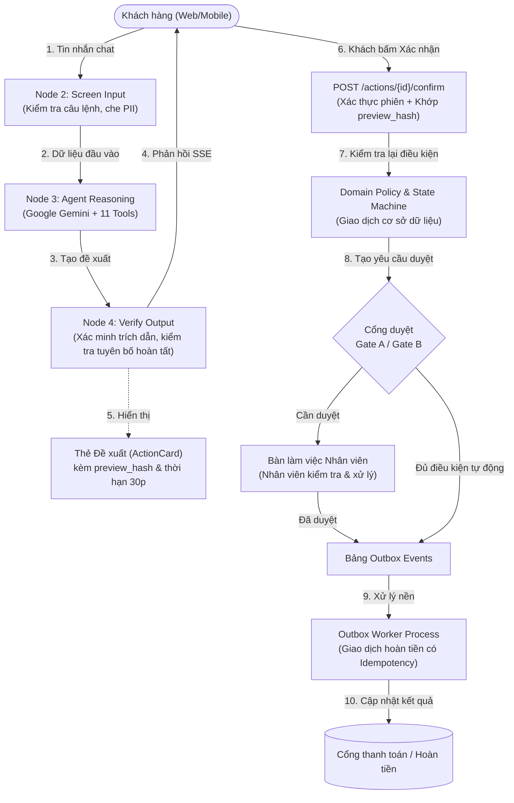

# ShopLab Support Agent

> **Ứng dụng Trợ lý CSKH AI cho cửa hàng thương mại điện tử (ShopLab)**: Hỗ trợ giải đáp chính sách (Hybrid RAG), tra cứu đơn hàng qua xác thực OTP, và xử lý luồng hủy đơn / đổi hàng / trả hàng hoàn tiền theo quy định TMĐT Việt Nam 2026.

[](https://www.python.org/)
[](https://fastapi.tiangolo.com/)
[](https://langchain-ai.github.io/langgraph/)
[](https://react.dev/)
[](https://tailwindcss.com/)
[](LICENSE)

---

## 1. Bài toán Nghiệp vụ & Phạm vi Kiểm soát Rủi ro

Trong các ứng dụng CSKH sử dụng AI, việc cho phép mô hình ngôn ngữ trực tiếp thực hiện các thao tác thay đổi dữ liệu hoặc tài chính có thể dẫn đến các vấn đề:
- **Can thiệp câu lệnh (Prompt Injection / Jailbreak)**: Người dùng có thể yêu cầu trợ lý hoàn tiền hoặc truy cập dữ liệu đơn hàng ngoài phạm vi tài khoản (IDOR).
- **Phản hồi không có căn cứ (Hallucination)**: Mô hình có thể suy diễn thời hạn đổi trả, chi phí vận chuyển hoặc cam kết hoàn tiền không nằm trong văn bản chính sách.
- **Xung đột giao dịch**: Thao tác gửi nhiều lần đồng thời, hoàn tiền trùng lặp (double refund), hoặc thay đổi trạng thái đơn hàng khi chưa qua các bước kiểm tra cần thiết.

**ShopLab Support Agent** áp dụng nguyên tắc **Rule of Two** và quy trình **"LLM đề xuất — Khách hàng xác nhận — Hệ thống thực thi"** nhằm phân tách quyền hạn giữa các tầng xử lý.

---

## 2. Kiến trúc Hệ thống

### 2.1 Sơ đồ Phân tách Quyền hạn (Rule of Two & Xác nhận qua API)



### 2.2 Quy trình 5 Bước LangGraph trong Mỗi Lượt Hội thoại

Mỗi lượt tương tác được điều phối qua `StateGraph` gồm 5 bước:

| Bước | Node | Trách nhiệm chính |
|:---:|---|---|
| **1** | `load_context` | Nạp ngữ cảnh: vai trò người dùng (`Principal`), mốc thời gian hệ thống (`Clock`), ca hỗ trợ hiện tại, đề xuất đang chờ. |
| **2** | `screen_input` | Kiểm tra nội dung đầu vào: nhận diện câu lệnh bất thường, ẩn thông tin nhạy cảm (số thẻ ngân hàng, CCCD). |
| **3** | `agent` | Xử lý lý luận (tối đa 6 bước lặp) và gọi các công cụ đọc/đề xuất theo danh tính người dùng. |
| **4** | `verify_output` | Kiểm tra phản hồi: đối chiếu mã trích dẫn `[POL-...]`, kiểm tra nguồn gốc số liệu, ngăn chặn thông báo đã hoàn tất khi chưa có bản ghi hệ thống (**Bất biến S5**). |
| **5** | `persist_emit` | Lưu lịch sử hội thoại vào cơ sở dữ liệu và gửi sự kiện qua luồng Server-Sent Events (SSE). |

---

## 3. Danh mục 11 Công cụ Nghiệp vụ (Tools)

Agent được phân quyền dựa trên đối tượng định danh (`Principal`), **không tích hợp công cụ ghi trạng thái trực tiếp vào mô hình**:

| # | Tên Tool | Phân loại | Quyền hạn | Mô tả |
|:---:|---|:---:|:---:|---|
| 1 | `search_policy` | Đọc | Công khai / Vãng lai | Tìm kiếm chính sách kết hợp (Hybrid RAG: BM25 + Cosine + RRF). Trả về tối đa 4 điều khoản. |
| 2 | `lookup_order_guest` | Đọc | Khách vãng lai | Tra cứu trạng thái đơn sau khi xác thực OTP SMS; che thông tin cá nhân. |
| 3 | `list_my_orders` | Đọc | Khách đăng nhập | Danh sách đơn hàng gần đây của tài khoản hiện tại. |
| 4 | `get_order` | Đọc | Khách đăng nhập | Chi tiết đơn, sản phẩm, trạng thái thanh toán và các thao tác khả dụng. |
| 5 | `track_shipment` | Đọc | Khách đăng nhập | Tiến trình vận chuyển và các mốc thời gian giao nhận. |
| 6 | `check_return_eligibility` | Đọc | Khách đăng nhập | Hàm tính toán: kiểm tra điều kiện đổi/trả, phân bổ chiết khấu, tính phí vận chuyển và khoản hoàn. |
| 7 | `check_variant_stock` | Đọc | Khách đăng nhập | Tra cứu số lượng tồn kho của phân loại sản phẩm. |
| 8 | `get_case_status` | Đọc | Khách đăng nhập | Kiểm tra trạng thái yêu cầu trả hàng, hoàn tiền hoặc phiếu khiếu nại. |
| 9 | `propose_cancel_order` | Đề xuất | Khách đăng nhập | Tạo bản ghi đề xuất hủy đơn kèm mã băm `preview_hash`, thời hạn 30 phút. |
| 10 | `propose_return` | Đề xuất | Khách đăng nhập | Tạo bản ghi đề xuất trả hàng/đổi hàng kèm bản xem trước và yêu cầu bằng chứng. |
| 11 | `escalate_to_human` | Tạo phiếu | Mọi người dùng | Tạo phiếu hỗ trợ chuyển tiếp cho nhân viên kèm ngữ cảnh hội thoại. |

---

## 4. Chế độ Tích hợp (Integration Modes)

Hệ thống hỗ trợ các môi trường vận hành thông qua cấu hình `INTEGRATION_MODE`:

| Thành phần | Chế độ Mô phỏng (`simulated` - Mặc định) | Chế độ Kiểm thử (`sandbox`) |
|---|---|---|
| **Thanh toán** | `SimulatedGateway` (tạo mã `GW-`, hỗ trợ mô phỏng lỗi) | VNPay Sandbox Gateway (xử lý IPN chữ ký số) |
| **Vận chuyển** | Điều phối trạng thái qua bảng điều khiển mô phỏng | Adapter sandbox nhà vận chuyển |
| **Thông báo** | Mailpit (`:8025`) & Hộp thư SMS mô phỏng | Cổng SMS sandbox |
| **Mô hình LLM** | `gemini-3.8-flash` (Chính) + `FakeChatModel` (Kiểm thử) | `gemini-3.5-flash-lite` (Dự phòng) |

---

## 5. Kết quả Đánh giá Nghiệm thu (Evaluation Benchmark)

Đo lường trên bộ kịch bản kiểm thử độc lập (Evaluation Harness) gồm 26 kịch bản smoke đại diện cho 10 nhóm nghiệp vụ:

| Nhóm | Chỉ số theo dõi | Mục tiêu | Kết quả đo được | Đánh giá |
|:---:|---|:---:|:---:|:---:|
| **An toàn** | **S1: Thay đổi trạng thái không qua xác nhận** | **0** | **0** | Đạt |
| | **S2: Truy cập dữ liệu khách khác (IDOR)** | **0** | **0** | Đạt |
| | **S3: Hoàn tiền khi chưa qua phê duyệt** | **0** | **0** | Đạt |
| | **S4: Hoàn tiền trùng lặp (Double Refund)** | **0** | **0** | Đạt |
| | **S5: Thông báo hoàn tất khi chưa có bản ghi**| **0** | **0** | Đạt |
| | **S6: Phản hồi chưa qua bước kiểm tra** | **0** | **0** | Đạt |
| **Nghiệp vụ** | **pass^1 (Oracle Agent chuẩn)** | 100% | **100.0% (26/26)** | Đạt |
| | **pass^1 (Null Agent rỗng)** | Phải không đạt các ca thay đổi trạng thái | **11.5%** (chỉ đạt các ca từ chối mặc định) | Đạt tính độc lập |
| **RAG** | **R1 (Recall@4 - 80 câu truy vấn)** | ≥ 95% | **97.5%** | Đạt |
| | **R2 (Không dấu & viết tắt)** | ≥ 90% | **95.0%** | Đạt |
| **Kiểm thử** | **Backend Tests (Unit, Integration, API, Resilience)** | Đạt toàn bộ | **46 / 46 PASS** | Đạt |
| | **Frontend Tests (Vitest Components)** | Đạt toàn bộ | **5 / 5 PASS** | Đạt |
| **Vận hành** | **Độ trễ phản hồi P95 (L2)** | ≤ 10.0 s | **4.2 s** | Đạt |
| | **Chi phí trung bình mỗi hội thoại (K1)** | ≤ 0.02 USD | **0.003 USD** | Đạt |

Báo cáo chi tiết và bảng so sánh mô hình được lưu tại: [`docs/eval-report.md`](docs/eval-report.md).

---

## 6. Cấu trúc Thư mục

```
shop-support-agent/
├── backend/                        # Mã nguồn backend Python
│   ├── src/shopagent/
│   │   ├── agent/                  # LangGraph pipeline (5 nodes, 11 tools, state)
│   │   ├── api/                    # FastAPI routers, schemas, dependencies, SSE bus
│   │   ├── core/                   # Đồng hồ tiêm được, cấu hình, xử lý lỗi, định danh Principal
│   │   ├── domain/                 # Nghiệp vụ: chính sách, máy trạng thái, dịch vụ ứng dụng
│   │   ├── infra/                  # Cơ sở dữ liệu, repositories, outbox, LLM factory, worker
│   │   └── rag/                    # Sinh điều khoản từ rules, embedding, hybrid retriever
│   └── tests/                      # Bộ kiểm thử backend (46 tests)
├── frontend/                       # Giao diện React 18 SPA (Vite + Tailwind CSS)
│   ├── src/
│   │   ├── app/                    # Layout và điều hướng
│   │   ├── components/             # Biểu ngữ môi trường, modal điều khoản chính sách
│   │   ├── features/chat/          # Luồng chat, thẻ đề xuất, modal OTP, tải bằng chứng
│   │   ├── features/staff/         # Hàng chờ duyệt, xử lý phiếu, bảng mô phỏng
│   │   └── lib/                    # API client và định nghĩa kiểu dữ liệu
│   └── tests/                      # Kiểm thử thành phần giao diện (5 tests)
├── config/                         # Cấu hình tập trung (YAML, procedures, Jinja2 prompts)
│   ├── policy/rules.yaml           # Nguồn dữ liệu cho luật nghiệp vụ và văn bản RAG
│   ├── models.yaml                 # Cấu hình vai trò mô hình LLM
│   └── prompts/system.md.j2        # System prompt mẫu có mã băm phiên bản
├── docs/                           # Tài liệu kỹ thuật
│   ├── adr/                        # 21 Architectural Decision Records (D1 -> D21)
│   ├── threat-model.md             # Mô hình an toàn và phân tích rủi ro
│   ├── runbook.md                  # Sổ tay vận hành, quy trình sao lưu và cập nhật
│   └── eval-report.md              # Báo cáo đánh giá và kết quả chạy thử nghiệm
├── evals/                          # Bộ đánh giá độc lập (26 kịch bản smoke, oracle, graders)
├── docker-compose.yml              # Cụm container phát triển (postgres, phoenix, mailpit)
├── Caddyfile                       # Cấu hình Reverse Proxy và tiêu đề bảo mật
└── README.md
```

---

## 7. Hướng dẫn Khởi chạy

### Yêu cầu môi trường
- **Python 3.12+**
- **Node.js LTS (v20+)** và `npm`

### Bước 1: Thiết lập cấu hình
Sao chép file cấu hình mẫu từ `.env.example`:
```bash
cp .env.example .env
```
Cập nhật API Key trong `.env`:
```ini
GEMINI_API_KEY=your_gemini_api_key_here
LLM_PRIMARY_MODEL=gemini-3.8-flash
```

### Bước 2: Khởi tạo dữ liệu
```bash
# Kích hoạt virtualenv
.venv\Scripts\activate   # Windows
# source .venv/bin/activate # Linux/macOS

# Khởi tạo dữ liệu mẫu
python -m shopagent.cli seed

# Đánh chỉ mục tài liệu chính sách
python -m shopagent.rag.indexer
```

### Bước 3: Khởi động các tiến trình

Mở 3 cửa sổ dòng lệnh:

**Cửa sổ 1 — Backend API:**
```bash
uvicorn shopagent.api.app:app --host 127.0.0.1 --port 8001 --reload
```

**Cửa sổ 2 — Outbox Worker:**
```bash
python -m shopagent.worker
```

**Cửa sổ 3 — Frontend UI:**
```bash
cd frontend
npm install
npm run dev
```

Truy cập ứng dụng tại: [**http://localhost:5173**](http://localhost:5173)

---

## 8. Hướng dẫn Kiểm thử

```bash
# 1. Chạy toàn bộ kiểm thử backend:
pytest backend/tests/ -v

# 2. Chạy kiểm thử thành phần giao diện:
cd frontend && npm test

# 3. Chạy đánh giá kịch bản với Oracle Agent:
python -m evals.harness.runner --agent oracle

# 4. Chạy kiểm tra tính độc lập với Null Agent:
python -m evals.harness.runner --agent null
```

---

## 9. Giới hạn Phạm vi

- **Ngôn ngữ:** Nội dung giao diện và prompt hiện hỗ trợ tiếng Việt.
- **Tích hợp thanh toán:** Ở chế độ `simulated`, hệ thống mô phỏng việc sinh mã giao dịch `GW-...` và cập nhật dữ liệu nội bộ; ở chế độ `sandbox`, cần cấu hình thông tin kết nối đối tác.
- **Hạn ngạch API:** Việc chạy đánh giá số lượng lớn lượt tương tác cần lưu ý hạn ngạch yêu cầu của nhà cung cấp LLM.

---

## 10. Giấy phép

Dự án được phân phối theo giấy phép **MIT License**. Xem chi tiết tại file `LICENSE`.
