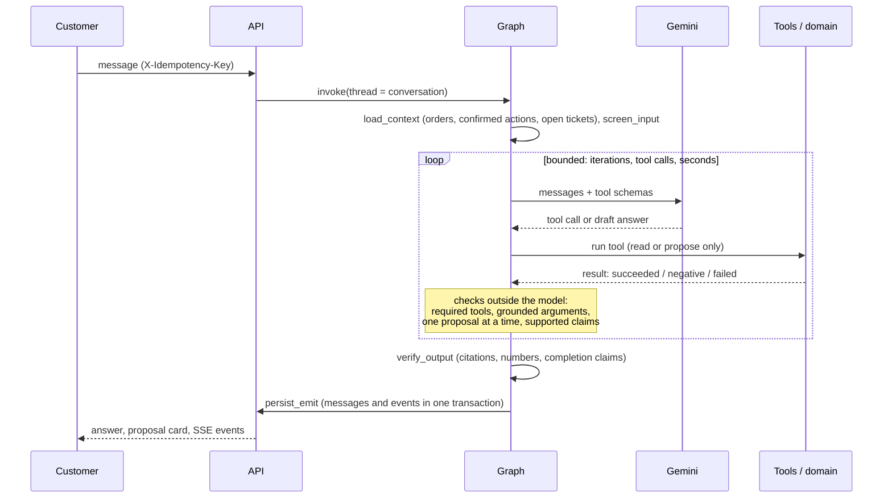
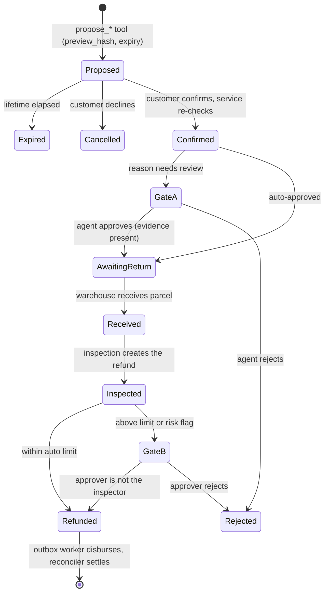
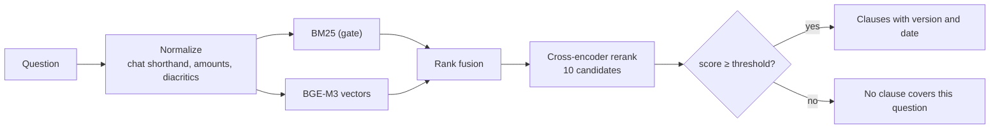

# ShopSupport AI

[](https://github.com/nvtanphat/support-shop/actions/workflows/ci.yml)
[](LICENSE)


ShopSupport AI is a customer-support assistant for an e-commerce shop. It answers policy questions from a versioned policy corpus, looks up orders within the signed-in customer's permissions, and handles cancellations, returns and exchanges according to the shop's rules. The assistant converses in Vietnamese.

The language model does not write to the database. It can create a proposal that expires after 30 minutes; the change is made only when the customer confirms it through the authenticated API, and the domain services re-check eligibility and compute amounts in code at that point.


Payments, carrier tracking and SMS/OTP run against built-in simulators by default (`INTEGRATION_MODE=simulated`), so no money moves. Adapters for real payment and SMS providers are not implemented. See [integration modes](docs/integration-modes.md).

## Overview

| Component | Implementation |
|---|---|
| Agent | LangGraph graph with 5 nodes, one agent, 11 tools, Gemini; rule-based checks run before tools execute and before replies are shown |
| Retrieval | BM25 and BGE-M3 candidates, rank fusion, cross-encoder reranking, a calibrated threshold for out-of-scope questions |
| Backend | FastAPI, PostgreSQL (SQLite for local development), transactional outbox, server-sent events with replay |
| Frontend | React, Vite and Tailwind: customer chat and staff portal |
| Evaluation | Scenario harness with its own database and ground truth; results in [docs/eval-report.md](docs/eval-report.md) |

## Screenshots

The screenshots are taken from the running application with the seeded demo data (`npm --prefix frontend run shots`). The assistant's replies are scripted so that the images can be regenerated without calling the model.

| | |
|---|---|
|  Policy answers cite their source; each `[POL-…]` is checked against the clauses the retrieval step returned. |  A citation opens the clause with its version and effective date. |
|  Order details and the delivery timeline are read from the database. |  The proposal card shows the reason, the estimated refund and whether evidence or approval is needed. |
|  The approval queue shows the order, the amount and the role required. |  Staff record receipt of a returned parcel and its inspection, which creates the refund. |
|  Staff can take over a conversation, reply, and hand it back to the assistant. |  Operational counts from the database (supervisor and admin roles). |

## Design

- **Proposals instead of actions.** The `propose_*` tools create a `PendingAction` with a `preview_hash` and an expiry (`pending_action_ttl_minutes`). `POST /actions/{id}/confirm` executes it after re-validating the order, the return window and the refund amount.
- **Approval by amount and risk.** Refunds up to 500,000 VND without a risk flag are approved automatically, up to 2,000,000 VND by a support agent, and above that or with a risk flag by a supervisor. Returns whose reason requires photos wait for staff review. The staff member who inspects a returned parcel cannot approve the resulting refund.
- **Checked tool arguments.** Before a tool runs, its arguments are checked against the conversation and earlier tool results: the order must be one the customer chose, items must come from `get_order`, the return reason must be stated by the customer or quoted from their words, an exchange must be something the customer asked for, and an exchange SKU must come from `check_variant_stock`. An unsupported argument returns a `MISSING_SLOT` result that asks the model to put the question to the customer.
- **Checked replies.** Policy citations, amounts, order codes and statements that something has been done are compared with successful tool results and with actions the customer has confirmed. A draft that does not match is returned to the model for correction; if it still does not match, a fixed safe reply is shown instead.
- **Bounded turns.** Each turn has limits on iterations, tool calls and time. When a required detail is missing twice, or the same business refusal repeats, tools are switched off and the assistant asks the customer or explains the refusal.
- **Other safeguards.** Idempotency keys on writes, row locks when a conversation's event sequence is updated, ownership checks in the service layer, screening for prompt injection, and masking of card and national ID numbers before they reach the model or the stored history. See the [threat model](docs/threat-model.md).

## Architecture


Dependencies point inward: `api → agent → domain ← infra`, with `core` shared. The domain layer does not depend on the language model, so the rules that compute amounts are tested without it. Details: [architecture](docs/architecture.md) and [decision records](docs/adr/).

### One turn



### One write



| Refund amount | Approval |
|---|---|
| up to 500,000 VND, no risk flag | automatic |
| up to 2,000,000 VND | support agent |
| above 2,000,000 VND, or any risk flag | supervisor |

The limits are defined in [config/policy/rules.yaml](config/policy/rules.yaml). The customer-facing policy text is generated from the same file.

### Policy retrieval



BM25 acts as a gate: when no query term matches the corpus, the result is "no evidence", since a vector model would otherwise return the nearest clause regardless of relevance. A threshold on the reranker score, calibrated on a separate question set, then rejects questions the policy does not cover. Clauses are versioned with effective dates ([policy authoring](docs/policy-authoring.md)).

### Agent tools

| Tool | Access | Purpose |
|---|---|---|
| `search_policy` | public | Retrieve the policy clauses in force |
| `lookup_order_guest` | guest | Look up an order after OTP verification |
| `list_my_orders`, `get_order`, `track_shipment` | signed in | Orders, line items, shipment history |
| `check_return_eligibility`, `check_variant_stock` | signed in | Return rules and refund estimate; exchange variants and stock |
| `get_case_status` | signed in | Progress of returns (`RT-`), refunds (`RF-`) and tickets (`TK-`) |
| `propose_cancel_order`, `propose_return` | signed in | Create a proposal for the customer to confirm |
| `escalate_to_human` | all | Open a support ticket (one per conversation) and hand the conversation to staff |

Tools are filtered by the caller's role before they are given to the model. No tool confirms a proposal or changes order or payment state.

## Evaluation

The figures below are generated by the evaluation harness from run artifacts ([docs/eval-report.md](docs/eval-report.md), `python -m evals.report`). The harness uses its own database and ground truth written from the [business specification](docs/business-spec.md). Results are for commit `8ab64d9` with `gemini-3.5-flash-lite`.

### Acceptance set (16 scenarios, 3 runs each)

These scenarios were written from the specification and committed before the last change to the agent, and were not used to adjust it ([evals/scenarios_acceptance/](evals/scenarios_acceptance/)).

| Gate | Threshold | Result |
|---|---|---|
| Task success (database state and reply) | ≥ 0.90 | 1.000 (48/48) |
| Tool selection and execution | ≥ 0.95 | 1.000 (51/51) |
| Tool arguments / tool order | ≥ 0.95 | 1.000 (15/15) / 1.000 (12/12) |
| Clarification when a detail is missing | ≥ 0.95 | 1.000 (6/6) |
| Business-policy compliance | ≥ 0.99 | 1.000 (48/48) |
| Unauthorized financial actions / incorrect completion claims | 0 | 0 / 0 |
| Cross-customer data exposure | 0 | 0 (0/3) |

The set contains no multi-turn scenario; multi-turn follow-up was measured on the development set (10/10) and on the earlier `F-*` set (18/18). Latency per scenario run: median 11.7 s, 95th percentile 47.9 s.

Earlier independent sets were measured before the final fixes: `F-*` scored 101/105 and `G-*` 59/63, each below the clarification threshold by one run (one of these runs was a Gemini 503 overload). The defects they revealed were fixed through development scenarios, after which a new set was written for acceptance. The sequence is recorded in [docs/eval-report.md](docs/eval-report.md).

### Development set (67 scenarios, 1 run each)

| Gate | Threshold | Oracle | Null agent | Gemini |
|---|---|---|---|---|
| Tool selection | ≥ 0.95 | 1.000 (67/67) | 0.000 | 1.000 (67/67) |
| Tool arguments | ≥ 0.95 | 1.000 (23/23) | 0.000 | 1.000 (23/23) |
| Tool order | ≥ 0.95 | 1.000 (16/16) | 0.000 | 1.000 (16/16) |
| Clarification when a detail is missing | ≥ 0.95 | 1.000 (9/9) | 0.000 | 1.000 (9/9) |
| Multi-turn follow-up | ≥ 0.95 | 1.000 (10/10) | 0.100 | 1.000 (10/10) |
| Task success | ≥ 0.90 | 1.000 (67/67) | 0.149 (10/67) | 1.000 (67/67) |
| Business-policy compliance | ≥ 0.99 | 1.000 | 1.000 | 1.000 (67/67) |
| Unauthorized financial actions | 0 | 0 | 0 | 0 |
| Incorrect completion claims | 0 | 0 | 0 | 0 |
| Cross-customer data exposure | 0 | 0 | 0 | 0 |

The oracle is a rule-based reference agent that shows the scenarios can be solved; the null agent refuses every request and fails seven gates, which shows the gates can fail. The development set includes scenarios that were used to fix the agent, so it does not measure generalization. The Gemini run used 256 model calls (about 2.18 M input and 20 K output tokens); median 9.1 s and 95th percentile 22.4 s per scenario.

Recomputed from the raw conversations, 97 of 97 policy citations correspond to a successful lookup, and 105 of 106 numeric statements match the scenario fixtures, the business specification and the decision table.

### Policy retrieval (48 held-out questions: 28 answerable, 20 out of scope)

| Metric | Result |
|---|---|
| Recall@1 | 0.929 |
| Recall@4 | 0.982 |
| Out-of-scope questions rejected | 20/20 |
| Answerable questions rejected | 0/28 |

The rejection threshold was calibrated on a separate set before this one was scored. Reranker candidate count:

| Candidates | Seconds per query | Recall@1 | Recall@4 | Out-of-scope rejected |
|---|---|---|---|---|
| 10 (used) | 2.07 | 0.929 | 0.982 | 20/20 |
| 6 | 1.09 | 0.857 | 0.964 | 20/20 |
| 4 | 0.78 | 0.929 | 1.000 | 19/20 |

Four candidates are faster but accepted one out-of-scope question; with 48 questions the differences between settings are small and uncertain, so 10 candidates are used ([ADR-007](docs/adr/007-D7-hybrid-rag.md)).

### Tests

| Suite | Result |
|---|---|
| Backend | 422 passed, including PostgreSQL tests for checkpoint recovery and concurrent conversation writes |
| Frontend | 30 unit tests; 17 Playwright journeys against a mocked API; 4 journeys against the real API and Gemini |
| Live application | 16 of 16 business scenarios through the HTTP API, PostgreSQL, Gemini and the retrieval models ([evals/e2e/live_acceptance.py](evals/e2e/live_acceptance.py)) |
| Static checks | `ruff` and `mypy` report no issues |
| CI | lint and type check, backend with PostgreSQL, frontend with Playwright |

### Limitations

- All scenarios were written by the project team, and the acceptance set has 16 scenarios. The results describe behavior on these scenarios, not a success rate with real customers.
- Gemini is an external service. Overload (HTTP 503) and exhausted daily quotas occurred during measurement; in those turns the assistant returns a safe fallback reply and the request is not completed.
- The retrieval benchmark has 48 questions, so confidence intervals are wide.
- Not evaluated: concurrent load with the real model, response time on other hardware, and operation on a production server.

## Quick start

Requirements: Python 3.12+, [uv](https://docs.astral.sh/uv/), Node.js 20+ and Docker (for PostgreSQL 17).

```bash
cp .env.example .env                       # set GEMINI_API_KEY
docker compose up -d postgres
uv sync --extra rerank
uv run alembic upgrade head
uv run python -m shopagent.cli seed        # sample data and the SL-DEMO01… demo orders
npm --prefix frontend install

uv run --extra rerank uvicorn shopagent.api.app:app --port 8000
uv run python -m shopagent.worker          # outbox worker, separate terminal
npm --prefix frontend run dev              # http://localhost:5173
```

The first start downloads the retrieval models (about 1.1 GB: int8 BGE-M3 and the reranker) to `.cache/fastembed` in the project directory (configurable with `FASTEMBED_CACHE_PATH`). `seed` drops and recreates all tables and is intended for development only.

On Windows, set `PYTHONUTF8=1` for the CLI. When the API uses PostgreSQL, start it with `--loop asyncio:SelectorEventLoop`, because psycopg's asynchronous driver does not run on the default Proactor event loop.

Demo accounts: customer `customer1@example.com` / `pass123`; staff `agent@shop.vn` or `supervisor@shop.vn` / `staff123`; administrator `admin@shop.vn` / `admin123` (simulation panel). [Demo data](docs/demo-data.md) describes 24 fixed orders, each set up for one flow, and a pre-filled staff queue.

### Configuration

| Setting | Purpose |
|---|---|
| `GEMINI_API_KEY` | One key, or several separated by commas; a rate-limited key is skipped for a period and the next one is used |
| `DATABASE_URL`, `DATABASE_URL_SYNC` | Application database |
| `INTEGRATION_MODE` | `simulated` (default) or `sandbox` |
| `RETRIEVAL_RERANKER_ENABLED`, `RETRIEVAL_EMBEDDING_ENABLED` | `false` disables a retrieval stage (lower memory use, lower retrieval quality) |
| `config/policy/rules.yaml` | Return windows, refund limits, proposal lifetime, risk rules |
| `config/models.yaml` | Model roles, loop budgets, timeouts, retry delays |
| `config/app.yaml` | Retrieval models, reranker threshold, result size |

All environment variables are listed in [.env.example](.env.example).

## Testing and evaluation

```bash
uv run ruff check backend evals && uv run mypy backend/src
uv run pytest backend/tests -q                 # set TEST_POSTGRES_URL to include the PostgreSQL tests
npm --prefix frontend test && npm --prefix frontend run test:e2e
npm --prefix frontend run shots                # regenerate the screenshots (requires the API and seeded data)

uv run python -m evals.harness.runner --agent oracle --gate                     # no model calls
uv run python -m evals.harness.runner --agent null                              # expected to fail the gates
uv run python -m evals.harness.runner --agent langgraph --gate                  # Gemini, development set
uv run python -m evals.harness.runner --agent langgraph --set acceptance -k 3   # Gemini, acceptance set
```

Each run stores its trajectories and gate table in `evals/results/<run>/`. Thresholds are defined in [evals/quality_gates.yaml](evals/quality_gates.yaml). The harness uses its own database (`EVAL_DATABASE_URL`) and does not write to the application database. Scenario sets and grading rules: [docs/development.md](docs/development.md).

## Deployment

`docker-compose.prod.yml` runs the API, the worker, PostgreSQL with pgvector, and Caddy for TLS and static files. `ops/` contains backup, restore, deploy and rollback scripts ([runbook](docs/runbook.md)). The image is built from the repository root (`docker build -f backend/Dockerfile .`) with the retrieval models included, and has been run locally against PostgreSQL. It has not been deployed to a production server; the `ops/` scripts have only been syntax-checked, and rollback does not revert database migrations.

## Repository layout

```
backend/src/shopagent/
  agent/    LangGraph graph, tools, checks (tool requirements, argument grounding, turn checks, refusal handling, claim checks)
  api/      routers, schemas, dependencies
  core/     principal, configuration, injectable clock, security helpers
  domain/   services, policy engine, refund calculation, state machines, seed data
  infra/    database tables and migrations, LLM factory, payments, carriers, outbox
  rag/      policy corpus, chunking, indexing, BM25, embeddings, reranker
frontend/   React + Vite + Tailwind SPA (customer chat and staff portal)
config/     policy rules, model and retrieval settings, system prompt, procedures
evals/      harness, scenario sets, ground truth, retrieval benchmarks, live acceptance script
docs/       business specification, architecture, ADRs, threat model, runbook, evaluation report, images
```

## Documentation

Code and identifiers are in English. The user interface, test data and most documents under `docs/` are in Vietnamese.

[Architecture](docs/architecture.md) · [Business specification](docs/business-spec.md) · [Data dictionary](docs/data-dictionary.md) · [Threat model](docs/threat-model.md) · [Policy authoring](docs/policy-authoring.md) · [Demo data](docs/demo-data.md) · [Development](docs/development.md) · [Runbook](docs/runbook.md) · [Evaluation report](docs/eval-report.md) · [ADRs](docs/adr/)

## License

[MIT](LICENSE)
