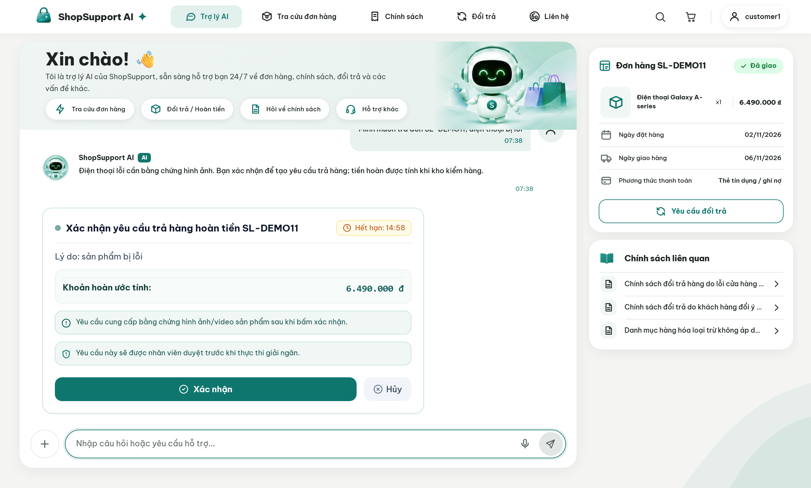

# ShopSupport AI

Trợ lý chăm sóc khách hàng cho sàn thương mại điện tử: trả lời chính sách bằng RAG, tra cứu đơn hàng theo quyền, và xử lý hủy đơn, đổi hàng, trả hàng hoàn tiền theo quy định thương mại điện tử Việt Nam.

Nguyên tắc cốt lõi: **LLM đề xuất, khách hàng xác nhận, hệ thống thực thi.** LLM không có quyền ghi vào cơ sở dữ liệu.



## Kiến trúc

- **LLM không có quyền ghi.** Tool `propose_*` chỉ tạo đề xuất kèm `preview_hash` và hạn 30 phút; hành động chạy khi khách gọi `POST /actions/{id}/confirm`, domain service kiểm tra lại và tính tiền bằng code.
- **Duyệt theo mức rủi ro.** Hoàn trên 500.000 đ cần nhân viên, trên 2.000.000 đ hoặc có cờ rủi ro cần trưởng ca; người kiểm hàng không tự duyệt khoản mình lập.
- **Trả lời phải có bằng chứng.** Trích dẫn `[POL-...]`, số liệu và tuyên bố "đã hoàn tất" được đối chiếu với kết quả tool trước khi gửi khách.


Chi tiết: [kiến trúc](docs/architecture.md) (tầng, vòng đời hành động, 11 tool, RAG), [ADR](docs/adr/).

## Kết quả đánh giá

| Hạng mục | Kết quả |
|---|---|
| Gemini thật, 44 kịch bản | 43/44 (k=1) |
| Hành động tài chính trái phép / tuyên bố sai / rò rỉ giữa khách | 0 / 0 / 0 |
| RAG holdout | Recall@1 0,93, từ chối ngoài phạm vi 1,00 |
| Test | Backend 194, Vitest 29, Playwright 17 |

Báo cáo đầy đủ và giới hạn: [docs/eval-report.md](docs/eval-report.md).

## Chạy cục bộ

Cần Python 3.12+, `uv`, Node.js 20+, PostgreSQL 17 (`docker compose up -d postgres`).

```bash
cp .env.example .env                      # điền GEMINI_API_KEY
uv sync --extra rerank
uv run alembic upgrade head
uv run python -m shopagent.cli seed       # dữ liệu mẫu + 24 đơn demo SL-DEMO01..
npm --prefix frontend install

uv run --extra rerank uvicorn shopagent.api.app:app --port 8000
uv run python -m shopagent.worker
npm --prefix frontend run dev             # http://localhost:5173, nhân viên ở /staff
```

Đăng nhập: `customer1@example.com` / `pass123`, `supervisor@shop.vn` / `staff123`. Từng đơn demo và tình huống của nó: [docs/demo-data.md](docs/demo-data.md). Cấu hình, kiểm thử, chạy eval: [docs/development.md](docs/development.md).

## Tài liệu

[Đặc tả nghiệp vụ](docs/business-spec.md) · [Từ điển dữ liệu](docs/data-dictionary.md) · [Vận hành](docs/runbook.md) · [Mô hình đe dọa](docs/threat-model.md) · [Chế độ tích hợp](docs/integration-modes.md)

## Giấy phép

MIT, xem [LICENSE](LICENSE).
