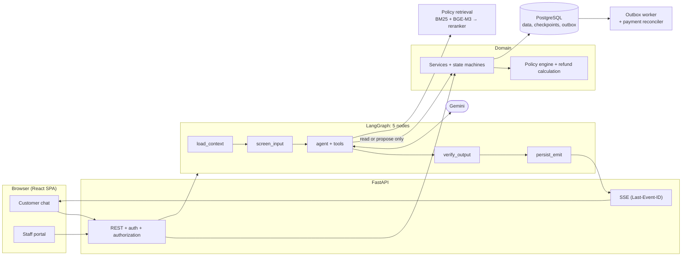

# ShopSupport AI

[](https://github.com/nvtanphat/support-shop/actions/workflows/ci.yml)
[](LICENSE)


A customer-support agent for e-commerce. It answers policy questions with retrieval-augmented generation, looks up orders under the caller's permissions, and handles cancellations, exchanges and refund returns under Vietnamese e-commerce rules. The assistant speaks Vietnamese.

**The model proposes, the customer confirms, the system executes.** The LLM has no write access to the database: it can only create a time-limited proposal. Every state change goes through an authenticated API and domain services that re-check eligibility and compute money in code.


> **Simulated by default.** Payments, carrier tracking and SMS/OTP run against built-in simulators (`INTEGRATION_MODE=simulated`); no money moves. There are no real VNPay or SMS adapters yet. See [integration modes](docs/integration-modes.md).

## Design guarantees

- **Proposals, not actions.** `propose_*` tools create a `PendingAction` with a `preview_hash` and a 30-minute expiry. Only `POST /actions/{id}/confirm` executes it, after re-validating the order, the policy window and the refund amount.
- **Approval scales with risk.** Refunds up to 500,000 VND are automatic, up to 2,000,000 VND need a support agent, and anything above that or carrying a risk flag needs a supervisor. The staff member who inspects a returned parcel cannot approve the refund they created (four-eyes).
- **Grounded answers.** Before a reply is shown, deterministic guards check that every policy citation `[POL-…]`, amount, order code and "done" claim is backed by a successful tool result, and that tool arguments (order, item, reason, exchange SKU) came from the customer or a tool, never from a guess. Failing replies are replaced, not shown.
- **Bounded turns.** A turn has limits on steps, tool calls and wall-clock time. It always ends with a grounded answer, a clarifying question, or an explicit error, including when the model times out or is rate-limited.
- **Safe by construction.** Idempotency keys on writes, atomic message and event sequencing, owner checks at the service layer, prompt-injection screening, and masking of card and national-ID numbers before the model or the stored history sees them. See the [threat model](docs/threat-model.md).

## Architecture



**One turn:** `load_context` loads the principal, clock and pending proposal → `screen_input` blocks injection and masks card numbers → `agent` runs the bounded tool loop with deterministic guards outside the model → `verify_output` checks citations, numbers and completion claims → `persist_emit` stores the messages and emits SSE events.

**One write:** the agent creates a proposal → the customer confirms it → the service re-checks and computes the refund → an approval request is created if the amount or risk requires it → the state change and an outbox event commit in one transaction → the worker disburses and the reconciler settles stuck payments.

Layers depend inward: `api → agent → domain ← infra`, with `core` shared. The domain layer has no LLM dependency. Details: [architecture](docs/architecture.md), [decision records](docs/adr/).

### Policy retrieval

Candidates come from BM25 (with query normalization for chat shorthand and amounts) fused by rank with BGE-M3 dense similarity; a cross-encoder (`bge-reranker-v2-m3`) then reorders them. A question whose best score is below a calibrated threshold is refused rather than answered with a loosely related clause. Policy clauses come from `config/policy/rules.yaml` (rules with numbers, so the text and the engine cannot disagree) and from Markdown documents; both are versioned with effective dates. See [policy authoring](docs/policy-authoring.md).

### Agent tools

| Tool | Access | Purpose |
|---|---|---|
| `search_policy` | public | Retrieve policy clauses in force |
| `lookup_order_guest` | guest | Look up an order after OTP verification |
| `list_my_orders`, `get_order`, `track_shipment` | signed in | Orders, line items, shipment history |
| `check_return_eligibility`, `check_variant_stock` | signed in | Return rules and refund estimate; exchange variants and stock |
| `get_case_status` | signed in | Return (`RT-`), refund (`RF-`) and ticket (`TK-`) progress |
| `propose_cancel_order`, `propose_return` | signed in | Create a proposal for the customer to confirm |
| `escalate_to_human` | everyone | Open a ticket and hand the conversation to staff |

## Quick start

Requires Python 3.12+, [uv](https://docs.astral.sh/uv/), Node.js 20+ and Docker (for PostgreSQL 17).

```bash
cp .env.example .env                       # set GEMINI_API_KEY
docker compose up -d postgres
uv sync --extra rerank
uv run alembic upgrade head
uv run python -m shopagent.cli seed        # sample data and the SL-DEMO01… demo orders
npm --prefix frontend install

uv run --extra rerank uvicorn shopagent.api.app:app --port 8000
uv run python -m shopagent.worker          # outbox worker, separate terminal
npm --prefix frontend run dev              # http://localhost:5173, staff portal under /staff
```

The first start downloads the retrieval models (about 1.1 GB: int8 BGE-M3 and the reranker) and loads them at startup. They are cached in `.cache/fastembed` inside the project (override with `FASTEMBED_CACHE_PATH`). On Windows set `PYTHONUTF8=1` for the CLI. `seed` drops and recreates every table: development only.

Sign in with `customer1@example.com` / `pass123`, or as staff with `agent@shop.vn` or `supervisor@shop.vn` / `staff123`. [Demo data](docs/demo-data.md) lists 24 fixed orders, each built for one flow (self-service cancel, return windows, excluded goods, evidence and approval gates, exchange stock, risk flags).

### Configuration

| Setting | Purpose |
|---|---|
| `GEMINI_API_KEY` | One key, or several separated by commas; a rate-limited key rests while the next is used |
| `DATABASE_URL`, `DATABASE_URL_SYNC` | Application database (PostgreSQL in production) |
| `INTEGRATION_MODE` | `simulated` (default) or `sandbox` |
| `RETRIEVAL_RERANKER_ENABLED`, `RETRIEVAL_EMBEDDING_ENABLED` | `false` turns a retrieval stage off (less RAM and disk, weaker retrieval) |
| `config/policy/rules.yaml` | Return windows, refund limits, proposal lifetime, risk rules |
| `config/models.yaml` | Model roles, loop budgets, timeouts and retry delays |
| `config/app.yaml` | Retrieval models, reranker threshold, result budget |

All variables are in [.env.example](.env.example).

## Testing and evaluation

```bash
uv run ruff check backend evals && uv run mypy backend/src
uv run pytest backend/tests -q                 # set TEST_POSTGRES_URL to include the PostgreSQL tests
npm --prefix frontend test && npm --prefix frontend run test:e2e
uv run python -m evals.harness.runner --agent oracle --gate              # no LLM calls
uv run python -m evals.harness.runner --agent langgraph --gate           # real Gemini, spends quota
uv run python -m evals.harness.runner --agent langgraph --set holdout    # held-out scenarios
```

| Check | Result |
|---|---|
| Backend tests | 393 pass including the PostgreSQL tests (`TEST_POSTGRES_URL`) |
| Frontend | 30 unit tests and 17 Playwright journeys against a mocked API |
| Agent, 62 development scenarios, real Gemini, one run each | 62/62, every quality gate met |
| Agent, 35 independent final scenarios (`--set holdout`, never used to tune) | not run yet: Gemini daily quota exhausted (see docs/eval-report.md) |
| Unauthorized financial actions, false completion claims, cross-customer leakage (development set) | 0 / 0 / 0 |
| Policy retrieval, 48-query holdout (28 answerable, 20 out of scope) | Recall@1 0.93, Recall@4 0.98, out-of-scope refusal 100% |

Read these with their limits: one run per scenario, scenarios written by the project team, and an oracle baseline that passes the development set (62/62). The null agent must fail the gates, and it passes 10/62. The development set includes 16 scenarios that used to be held out; they moved there once their failures had been used to fix the agent, and a new independent set replaced them. Full report and caveats: [docs/eval-report.md](docs/eval-report.md); how the harness grades: [docs/development.md](docs/development.md).

## Deployment

`docker-compose.prod.yml` runs the API, worker, PostgreSQL (pgvector) and Caddy for TLS and static files; `ops/` has backup, restore, deploy and rollback scripts ([runbook](docs/runbook.md)). The deployment path has not been exercised on a real server: the Docker image is unbuilt, the scripts are only syntax-checked, and rollback does not undo migrations. Rehearse backup, restore and rollback before relying on them.

## Repository layout

```
backend/src/shopagent/
  agent/    LangGraph graph, tools, guards (tool requirements, slot grounding, claim checks)
  api/      routers, schemas, dependencies
  core/     principal, configuration, injectable clock, security helpers
  domain/   services, policy engine, refund calculation, state machines, seed data
  infra/    database tables and migrations, LLM factory, payments, carriers, outbox
  rag/      policy corpus, chunking, indexing, BM25, embeddings, reranker
frontend/   React + Vite + Tailwind SPA (customer chat and staff portal)
config/     policy rules, model and retrieval settings, system prompt, procedures
evals/      harness, scenarios and held-out scenarios, ground truth, retrieval benchmarks
docs/       business spec, architecture, ADRs, threat model, runbook, evaluation report
```

## Documentation

Code and identifiers are in English. The user interface, test data and most prose under `docs/` are in Vietnamese.

[Architecture](docs/architecture.md) · [Business specification](docs/business-spec.md) · [Data dictionary](docs/data-dictionary.md) · [Threat model](docs/threat-model.md) · [Policy authoring](docs/policy-authoring.md) · [Demo data](docs/demo-data.md) · [Development](docs/development.md) · [Runbook](docs/runbook.md) · [Evaluation report](docs/eval-report.md) · [ADRs](docs/adr/)

## License

[MIT](LICENSE)
