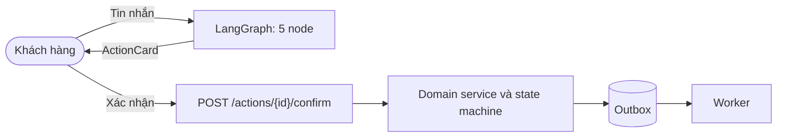

# ShopSupport AI

Trợ lý chăm sóc khách hàng cho sàn thương mại điện tử: trả lời chính sách bằng RAG, tra cứu đơn hàng theo quyền, và xử lý hủy đơn, đổi hàng, trả hàng hoàn tiền theo quy định thương mại điện tử Việt Nam.

Nguyên tắc cốt lõi: **LLM đề xuất, khách hàng xác nhận, hệ thống thực thi.** LLM không có quyền ghi vào cơ sở dữ liệu.

## Kiến trúc

- LLM chỉ tạo `ActionProposal` có `preview_hash` và hạn 15 phút. Hành động chỉ chạy khi khách gọi `POST /actions/{id}/confirm`; domain service kiểm tra lại điều kiện và tính tiền hoàn bằng code.
- Hoàn tiền trên 500.000 đ cần nhân viên duyệt, trên 2.000.000 đ hoặc có cờ rủi ro cần trưởng ca (`config/policy/rules.yaml`). Người kiểm hàng không được tự duyệt khoản hoàn mình vừa lập.
- Số thứ tự tin nhắn và sự kiện SSE cấp phát nguyên tử bằng khóa bi quan trên PostgreSQL; client gửi `X-Idempotency-Key` để khử trùng lặp.



### Một lượt hội thoại

1. `load_context`: nạp `Principal`, đồng hồ hệ thống, đề xuất đang chờ.
2. `screen_input`: chặn prompt injection, che PII.
3. `agent`: Gemini gọi tool. Vòng lặp có giới hạn số bước, số lần gọi tool và thời gian; thiếu tool bắt buộc thì bị nhắc tối đa 2 lần rồi trả lời `requirements_unmet`.
4. `verify_output`: đối chiếu trích dẫn `[POL-...]`, số liệu và tuyên bố hoàn tất với kết quả tool thành công.
5. `persist_emit`: lưu tin nhắn và phát sự kiện SSE.

Quyết định thiết kế chi tiết nằm ở [docs/adr/](docs/adr/), riêng cơ chế điều khiển lượt ở [ADR 022](docs/adr/022-D22-agent-turn-control.md).

### Tìm kiếm chính sách

BM25 trên điều khoản chính sách, chuẩn hóa câu hỏi (viết tắt, số tiền), khôi phục dấu tiếng Việt, rồi tùy chọn xếp hạng lại bằng cross-encoder `BAAI/bge-reranker-v2-m3-int8`. Câu hỏi có điểm dưới ngưỡng `retrieval.reranker.min_score` trong [config/app.yaml](config/app.yaml) bị từ chối thay vì trả điều khoản gần đúng.

## 11 công cụ nghiệp vụ

| Tool | Quyền | Mô tả |
|---|---|---|
| `search_policy` | Công khai | Tra cứu điều khoản chính sách |
| `lookup_order_guest` | Khách vãng lai | Tra cứu đơn sau khi xác thực OTP |
| `list_my_orders` | Đăng nhập | Danh sách đơn gần đây |
| `get_order` | Đăng nhập | Chi tiết đơn, thanh toán, vận chuyển |
| `track_shipment` | Đăng nhập | Lịch sử vận chuyển |
| `check_return_eligibility` | Đăng nhập | Điều kiện đổi trả và số tiền hoàn |
| `check_variant_stock` | Đăng nhập | Tồn kho SKU muốn đổi |
| `get_case_status` | Đăng nhập | Tiến độ hồ sơ `RT-`, `RF-`, `TK-` |
| `propose_cancel_order` | Đăng nhập | Đề xuất hủy đơn |
| `propose_return` | Đăng nhập | Đề xuất đổi hoặc trả hàng |
| `escalate_to_human` | Mọi người | Chuyển nhân viên khi có tranh chấp |

## Kết quả đánh giá

Số liệu đo ngày 12-13/11/2026. Báo cáo đầy đủ, giới hạn và mục chưa kiểm chứng: [docs/eval-report.md](docs/eval-report.md), sinh tự động từ artifact bằng `python -m evals.report`.

| Hạng mục | Kết quả | Ghi chú |
|---|---|---|
| Gemini thật, 44 kịch bản | 43/44 (97,7%) | k=1; một kịch bản chấm lại sau khi sửa bộ chấm |
| Oracle (không dùng LLM) | 44/44 | kiểm tra bộ chấm và kịch bản |
| Null agent | 6/44, trượt cổng | bộ chấm không cho qua agent rỗng |
| Hành động tài chính trái phép, tuyên bố sai, rò rỉ giữa khách | 0 / 0 / 0 | |
| RAG trên tập holdout | Recall@1 0,93, Recall@4 0,98, từ chối ngoài phạm vi 1,00 | 28 câu hợp lệ, 20 câu ngoài phạm vi |
| Backend | 182 test đạt, 4 test PostgreSQL bỏ qua khi không đặt `TEST_POSTGRES_URL` | CI chạy đủ với PostgreSQL |
| Frontend | Vitest 28/28, Playwright 16/16 (đủ 9 luồng của kế hoạch), build sạch | API được giả lập; chưa chạy với backend thật |

Chưa kiểm chứng: ảnh Docker chưa build, chưa chạy lặp k ≥ 3, chưa thử tải đồng thời với Gemini thật.

## Cấu trúc thư mục

```
backend/src/shopagent/
  agent/    đồ thị LangGraph, tool, guard (tool_requirements, slot_guard, grounding), checkpoint
  api/      router, schema, dependency, health
  core/     Principal, cấu hình, đồng hồ tiêm được
  domain/   nghiệp vụ, policy engine, tính tiền hoàn
  infra/    bảng DB, migration, LLM factory, outbox
  rag/      chunking, index, BM25, khôi phục dấu, reranker
backend/tests/   unit, api, integration
frontend/src/    app, features/chat, features/staff, components, lib, styles
config/          app.yaml, models.yaml, policy, prompt hệ thống
docs/            spec nghiệp vụ, runbook, threat model, ADR, báo cáo đánh giá, design/
evals/           harness, 44 kịch bản, bộ truy vấn chính sách, báo cáo
```

## Chạy cục bộ

Cần Python 3.12+, `uv`, Node.js 20+. PostgreSQL 17 chạy qua `docker compose up -d postgres` (chuỗi kết nối mặc định ở `.env.example`).

```bash
cp .env.example .env              # điền GEMINI_API_KEY
uv sync --extra rerank            # bỏ --extra rerank nếu không dùng reranker
uv run alembic upgrade head
uv run python -m shopagent.cli seed
uv run python -m shopagent.cli index-policies
npm --prefix frontend install
```

```bash
uv run --extra rerank uvicorn shopagent.api.app:app --port 8000   # API, nạp reranker khi khởi động
uv run python -m shopagent.worker                                 # outbox worker
npm --prefix frontend run dev                                     # giao diện: http://localhost:5173
```

Giao diện nhân viên ở `/staff`. Dữ liệu mẫu có `customer1@example.com` / `pass123` và `agent@shop.vn` / `staff123`; chỉ dùng cho môi trường phát triển.

### Cấu hình đáng chú ý

- `RETRIEVAL_RERANKER_ENABLED=false` tắt reranker (mặc định bật trong `config/app.yaml`; mô hình khoảng 1 GB RAM).
- `GEMINI_API_KEY` nhận nhiều khóa cách nhau bằng dấu phẩy; khóa bị giới hạn tốc độ được nghỉ tạm và hệ thống chuyển sang khóa khác.
- Hạn mức vòng lặp agent, thời gian chờ và số lần thử lại LLM ở [config/models.yaml](config/models.yaml).
- Bộ nhớ đệm nặng (mô hình reranker) đặt qua `FASTEMBED_CACHE_PATH` và `HF_HOME`.

## Kiểm thử và đánh giá

```bash
uv run ruff check backend evals
uv run mypy backend/src
uv run pytest backend/tests -q                     # đặt TEST_POSTGRES_URL để chạy test PostgreSQL
npm --prefix frontend test
npm --prefix frontend run test:e2e                 # API giả lập
npm --prefix frontend exec playwright test -- --config playwright.live.config.ts   # giao diện + API + Gemini thật, tốn hạn mức

uv run python -m evals.harness.runner --agent oracle --gate       # không gọi LLM
uv run python -m evals.harness.runner --agent null                # phải trượt cổng chất lượng
uv run python -m evals.harness.runner --agent langgraph --gate    # gọi Gemini thật, tốn hạn mức
uv run --extra rerank python -m evals.retrieval.holdout           # đo retrieval, không gọi LLM
```

Mỗi lần chạy lưu quỹ đạo thô và bảng cổng chất lượng vào `evals/results/<run>/`. Ngưỡng cổng ở [evals/quality_gates.yaml](evals/quality_gates.yaml). Harness ghi vào cơ sở dữ liệu riêng (`EVAL_DATABASE_URL`), không bao giờ vào cơ sở dữ liệu ứng dụng.

Tài liệu liên quan: [kiến trúc](docs/architecture.md), [chế độ tích hợp](docs/integration-modes.md), [từ điển dữ liệu](docs/data-dictionary.md), [vận hành](docs/runbook.md), [mô hình đe dọa](docs/threat-model.md), [đặc tả nghiệp vụ](docs/business-spec.md), [quy tắc làm việc](AGENTS.md).

## Giấy phép

MIT, xem [LICENSE](LICENSE).
