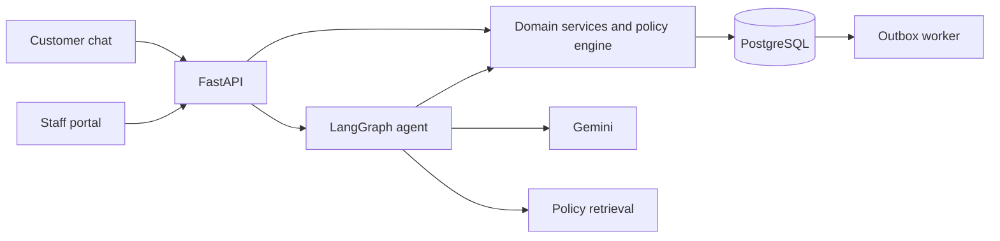
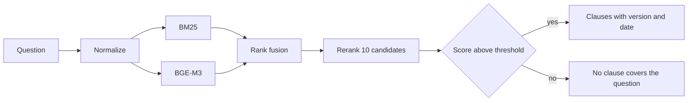

# ShopSupport AI

[](https://github.com/nvtanphat/support-shop/actions/workflows/ci.yml)
[](LICENSE)


A customer-support assistant for an e-commerce shop. It answers policy questions from a versioned policy corpus, looks up orders within the signed-in customer's permissions, and handles cancellations, returns and exchanges. The assistant converses in Vietnamese.

The language model does not write to the database. It creates a proposal that expires after 30 minutes; the change is made only when the customer confirms it through the authenticated API, and the domain services re-check eligibility and compute amounts in code at that point.


Payments, carrier tracking and SMS/OTP use built-in simulators by default (`INTEGRATION_MODE=simulated`), so no money moves. See [integration modes](docs/integration-modes.md). More screenshots are in [docs/images/](docs/images/).

## Components

| Component | Implementation |
|---|---|
| Agent | LangGraph, 5 nodes, one agent with 11 tools, Gemini |
| Retrieval | BM25 and BGE-M3 candidates, rank fusion, cross-encoder reranking, a threshold for out-of-scope questions |
| Backend | FastAPI, PostgreSQL (SQLite for local development), transactional outbox, server-sent events |
| Frontend | React, Vite, Tailwind: customer chat and staff portal |
| Evaluation | Scenario harness with its own database and ground truth |

## Design

- **Proposals instead of actions.** `propose_*` tools create a pending action with a hash and an expiry. `POST /actions/{id}/confirm` executes it after re-validating the order, the return window and the refund amount.
- **Approval by amount and risk.** Refunds up to 500,000 VND with no risk flag are automatic, up to 2,000,000 VND need a support agent, and anything above that or flagged needs a supervisor. The staff member who inspects a returned parcel cannot approve the resulting refund. Limits are in [config/policy/rules.yaml](config/policy/rules.yaml).
- **Checked tool arguments.** Before a tool runs, its arguments are compared with the conversation and earlier tool results: the order must be one the customer chose, items come from `get_order`, the return reason is stated by the customer or quoted from their words, and an exchange is only used when the customer asked for one. Otherwise the tool returns `MISSING_SLOT` and the assistant asks the customer.
- **Checked replies.** Citations, amounts, order codes and "done" statements are compared with successful tool results and with actions the customer confirmed. A draft that does not match goes back to the model once; if it still does not match, a fixed fallback reply is shown.
- **Bounded turns.** Each turn has limits on iterations, tool calls and time. When a detail is missing twice or the same business refusal repeats, tools are switched off and the assistant asks or explains.
- **Other safeguards.** Idempotency keys, row locks on conversation counters, ownership checks in services, prompt-injection screening, masking of card and ID numbers. See the [threat model](docs/threat-model.md).

## Architecture



One turn runs `load_context`, `screen_input`, `agent` (a bounded loop of model and tool calls), `verify_output` and `persist_emit`. The domain layer does not depend on the model, so the rules that compute amounts are tested without it. Details: [architecture](docs/architecture.md), [decision records](docs/adr/).



Agent tools: `search_policy`, `lookup_order_guest`, `list_my_orders`, `get_order`, `track_shipment`, `check_return_eligibility`, `check_variant_stock`, `get_case_status`, `propose_cancel_order`, `propose_return`, `escalate_to_human`. Tools are filtered by the caller's role, and none of them confirms a proposal or changes order or payment state.

## Evaluation

Figures come from the harness ([docs/eval-report.md](docs/eval-report.md)) for commit `8ab64d9` with `gemini-3.5-flash-lite`. Ground truth is written from the [business specification](docs/business-spec.md).

**Acceptance set**: 16 scenarios written before the last change to the agent and not used to adjust it, 3 runs each.

| Gate | Threshold | Result |
|---|---|---|
| Task success | ≥ 0.90 | 1.000 (48/48) |
| Tool selection and execution | ≥ 0.95 | 1.000 (51/51) |
| Clarification when a detail is missing | ≥ 0.95 | 1.000 (6/6) |
| Business-policy compliance | ≥ 0.99 | 1.000 (48/48) |
| Unauthorized financial actions, incorrect completion claims | 0 | 0, 0 |
| Cross-customer data exposure | 0 | 0 (0/3) |

This set has no multi-turn scenario. Multi-turn follow-up scored 10/10 on the 67-scenario development set. Two earlier independent sets (`F-*`, `G-*`) scored 101/105 and 59/63, each one run below the clarification threshold; the defects they showed were fixed and a new set was written for acceptance ([history](docs/eval-report.md)).

**Development set**: 67 scenarios, 1 run each, Gemini 67/67. It includes scenarios used to fix the agent, so it does not measure generalization. The rule-based oracle scores 67/67 and the always-refusing null agent 10/67, which shows the gates can fail.

**Retrieval**: 48 held-out questions (28 answerable, 20 out of scope): Recall@1 0.929, Recall@4 0.982, 20/20 out-of-scope questions rejected, 0/28 answerable questions rejected.

**Tests**: 422 backend tests including PostgreSQL, 30 frontend unit tests, 17 browser journeys, and 16 of 16 live business scenarios through the HTTP API, PostgreSQL, Gemini and the retrieval models.

**Limitations**
- Scenarios were written by the project team, and the acceptance set is small. The results describe these scenarios, not a success rate with real customers.
- Gemini is an external service. Overload (HTTP 503) and exhausted daily quotas occurred during measurement; the assistant then returns a fallback reply and the request is not completed.
- Not evaluated: concurrent load with the real model, other hardware, a production server.

## Quick start

Requires Python 3.12+, [uv](https://docs.astral.sh/uv/), Node.js 20+ and Docker (PostgreSQL 17).

```bash
cp .env.example .env                       # set GEMINI_API_KEY
docker compose up -d postgres
uv sync --extra rerank
uv run alembic upgrade head
uv run python -m shopagent.cli seed        # sample data and the SL-DEMO01… demo orders
npm --prefix frontend install

uv run --extra rerank uvicorn shopagent.api.app:app --port 8000
uv run python -m shopagent.worker          # outbox worker, separate terminal
npm --prefix frontend run dev              # http://localhost:5173
```

The first start downloads the retrieval models (about 1.1 GB) to `.cache/fastembed`. `seed` drops and recreates all tables: development only. On Windows set `PYTHONUTF8=1`, and start the API with `--loop asyncio:SelectorEventLoop` when it uses PostgreSQL.

Demo accounts: customer `customer1@example.com` / `pass123`; staff `agent@shop.vn` or `supervisor@shop.vn` / `staff123`; administrator `admin@shop.vn` / `admin123`. [Demo data](docs/demo-data.md) describes 24 fixed orders. Settings are listed in [.env.example](.env.example), `config/policy/rules.yaml`, `config/models.yaml` and `config/app.yaml`.

## Testing

```bash
uv run ruff check backend evals && uv run mypy backend/src
uv run pytest backend/tests -q                 # set TEST_POSTGRES_URL to include PostgreSQL tests
npm --prefix frontend test && npm --prefix frontend run test:e2e

uv run python -m evals.harness.runner --agent oracle --gate                     # no model calls
uv run python -m evals.harness.runner --agent langgraph --set acceptance -k 3   # Gemini, acceptance set
```

Runs are stored in `evals/results/<run>/`; thresholds are in [evals/quality_gates.yaml](evals/quality_gates.yaml). The harness uses its own database. Scenario sets and grading: [docs/development.md](docs/development.md).

## Deployment

`docker-compose.prod.yml` runs the API, the worker, PostgreSQL and Caddy. `ops/` has backup, restore, deploy and rollback scripts ([runbook](docs/runbook.md)). The image builds from the repository root (`docker build -f backend/Dockerfile .`) and has been run locally against PostgreSQL. It has not been deployed to a production server, and rollback does not revert migrations.

## Documentation

Code is in English; the interface and most documents under `docs/` are in Vietnamese.

[Architecture](docs/architecture.md) · [Business specification](docs/business-spec.md) · [Data dictionary](docs/data-dictionary.md) · [Threat model](docs/threat-model.md) · [Policy authoring](docs/policy-authoring.md) · [Demo data](docs/demo-data.md) · [Development](docs/development.md) · [Runbook](docs/runbook.md) · [Evaluation report](docs/eval-report.md) · [ADRs](docs/adr/)

## License

[MIT](LICENSE)
