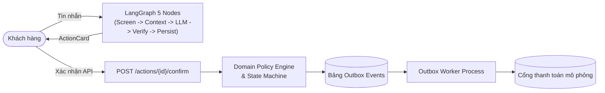

# ShopSupport AI — Customer Support Agent

Ứng dụng Trợ lý Chăm sóc Khách hàng AI cho sàn thương mại điện tử: Giải đáp chính sách (Hybrid RAG), tra cứu đơn hàng phân quyền bảo mật, và xử lý luồng hủy đơn / đổi hàng / trả hàng hoàn tiền theo nguyên tắc **Rule of Two** và quy định TMĐT Việt Nam 2026.

---

## 1. Kiến trúc Cốt lõi & Kiểm soát An ninh

Hệ thống áp dụng nguyên tắc **"LLM đề xuất — Khách hàng xác nhận — Hệ thống thực thi"**:
- **Không trao quyền đột biến cho LLM**: LLM không có quyền sửa DB hay kích hoạt thanh toán trực tiếp; chỉ phát sinh đề xuất (`ActionProposal`) kèm mã băm `preview_hash` và thời hạn 15 phút.
- **Xác nhận qua API bảo mật**: Khách hàng bấm nút xác nhận trực tiếp trên giao diện (`POST /actions/{id}/confirm`). Domain Service kiểm tra lại toàn bộ điều kiện và tính toán số tiền hoàn tất định trước khi ghi Outbox.
- **Phân tách quyền hạn Dual-Key**: Đơn hoàn tiền $\ge 500.000$ đ hoặc rủi ro cao bắt buộc chuyển sang bàn làm việc nhân viên (`PENDING_STAFF_APPROVAL`).
- **Chống Race Condition & Idempotency 2 tầng**: Sequence tin nhắn và sự kiện SSE được cấp phát nguyên tử qua khóa bi quan `with_for_update()` trên PostgreSQL. Phía Client gửi `X-Idempotency-Key` (turn_id) để khử trùng lặp hiển thị.



### Quy trình 5 Bước LangGraph trong Mỗi Lượt Hội thoại
1. `load_context`: Nạp định danh (`Principal`), mốc thời gian hệ thống (`Clock`), và ngữ cảnh đề xuất đang chờ.
2. `screen_input`: Nhận diện Prompt Injection, lọc đầu vào bất thường và che giấu PII (số thẻ, CCCD, điện thoại).
3. `agent`: Lý luận và gọi công cụ (Gemini Flash Lite + 11 Tools nghiệp vụ phân quyền theo Principal).
4. `verify_output`: Đối chiếu trích dẫn `[POL-...]`, kiểm tra nguồn gốc số liệu, chặn tuyên bố hoàn tất sai sự thật (Bất biến S5).
5. `persist_emit`: Cấp phát số thứ tự tin nhắn nguyên tử, lưu DB và phát sự kiện qua Server-Sent Events (SSE).

---

## 2. Danh mục 11 Công cụ Nghiệp vụ (Tools)

| # | Tên Tool | Quyền hạn | Mô tả |
|:---:|---|:---:|---|
| 1 | `search_policy` | Công khai | Tra cứu điều khoản chính sách Hybrid RAG (BM25 + Semantic Cosine + RRF). |
| 2 | `lookup_order_guest` | Khách vãng lai | Tra cứu trạng thái đơn hàng sau khi xác thực OTP SMS; che thông tin nhạy cảm. |
| 3 | `list_my_orders` | Khách đăng nhập | Xem danh sách đơn hàng gần đây của tài khoản. |
| 4 | `get_order` | Khách đăng nhập | Xem chi tiết đơn hàng, sản phẩm, trạng thái thanh toán và vận chuyển. |
| 5 | `track_shipment` | Khách đăng nhập | Theo dõi tiến trình vận chuyển và lịch sử quét mã kiện hàng. |
| 6 | `check_return_eligibility`| Khách đăng nhập | Kiểm tra điều kiện đổi/trả, phân bổ voucher và tính toán tiền hoàn tất định. |
| 7 | `check_variant_stock` | Khách đăng nhập | Kiểm tra số lượng tồn kho của SKU sản phẩm muốn đổi sang. |
| 8 | `get_case_status` | Khách đăng nhập | Tra cứu tiến độ hồ sơ đổi trả (`RT-`), hoàn tiền (`RF-`), hoặc phiếu hỗ trợ (`TK-`). |
| 9 | `propose_cancel_order` | Khách đăng nhập | Tạo đề xuất hủy đơn hàng để khách xác nhận (không tự ý hủy trực tiếp). |
| 10 | `propose_return` | Khách đăng nhập | Tạo đề xuất đổi hàng hoặc trả hàng hoàn tiền kèm phân tích chi phí. |
| 11 | `escalate_to_human` | Mọi người dùng | Tạo Ticket chuyển tiếp cho nhân viên hỗ trợ khi có tranh chấp hoặc sự cố thanh toán. |

---

## 3. Kết quả Đánh giá Nghiệm thu (Quality Gates)

Số liệu đã đo trong lần audit 12-13/11/2026 (chi tiết, giới hạn và mục `NOT VERIFIED` ở [`docs/eval-report.md`](docs/eval-report.md)):

| Nhóm kiểm thử | Công cụ / Tiêu chí | Kết quả thực tế | Trạng thái |
|---|---|:---:|:---:|
| **An toàn & Tài chính** | Hành động tài chính trái phép, tuyên bố hoàn tất sai, rò rỉ giữa khách (Gemini thật, 44 kịch bản) | **0 / 0 / 0** | **ĐẠT** |
| **Mô hình chuẩn (Oracle)** | 44 kịch bản (có kiểm tra tool, tham số, thứ tự, hỏi thiếu thông tin) | **44/44** | **ĐẠT** |
| **Mô hình thật (LangGraph)** | Gemini 3.5 Flash Lite, 44 kịch bản, k=1, bật reranker | **40/44 (90,9%)**; 4 lỗi còn lại đều do 429 giới hạn tốc độ, chạy lại 4/4 đạt | **ĐẠT** (cổng 90%, mẫu nhỏ, chưa lặp k≥3) |
| **Tính độc lập (Null Agent)** | Chỉ từ chối mặc định, không thực thi giao dịch; phải trượt cổng chất lượng | **6/44, trượt cổng** | **ĐẠT** |
| **Code Quality & Lint** | Ruff Linter & Formatter | **0 lỗi / 0 cảnh báo** | **ĐẠT** |
| **Type Safety** | Mypy | **0 lỗi (113 source files)** | **ĐẠT** |
| **Backend Unit & Integration** | Pytest với PostgreSQL thật (gồm checkpoint async) | **156/156 PASS** | **ĐẠT** |
| **RAG (benchmark độc lập, 50 câu test)** | Recall@1 / Recall@4 / từ chối câu ngoài phạm vi | 0,92 / 0,97 / **0,31** (ngưỡng từ chối 0,95) | **KHÔNG ĐẠT** |
| **Frontend Unit Tests** | Vitest Component Tests | **5/5 PASS** | **ĐẠT** |
| **Frontend E2E Journeys** | Playwright Chromium Headless | chưa chạy trong lần audit này | **NOT VERIFIED** |
| **Frontend Build** | TypeScript + Vite Production Build | **0 lỗi** | **ĐẠT** |

Chi tiết báo cáo đo kiểm: [`docs/eval-report.md`](docs/eval-report.md).

---

## 4. Cấu trúc Thư mục

```
shop-support-agent/
├── backend/                        # Backend Python (FastAPI + LangGraph + SQLAlchemy)
│   ├── src/shopagent/
│   │   ├── agent/                  # LangGraph StateGraph (5 nodes, 11 tools, durable checkpoint)
│   │   ├── api/                    # Routers, schemas, dependencies, health/readiness probes
│   │   ├── core/                   # Principal identity, config, security, clock tiêm được
│   │   ├── domain/                 # Logic nghiệp vụ thuần túy, policy engine, refund calculator
│   │   ├── infra/                  # DB models, Alembic migrations, repositories, outbox worker
│   │   └── rag/                    # Chunking, indexing, lexical BM25 + semantic hybrid retriever
│   └── tests/                      # Bộ 57 tests backend (unit, integration, resilience)
├── frontend/                       # Frontend React 18 SPA (Vite + Tailwind CSS)
│   ├── src/
│   │   ├── features/chat/          # Khung chat, bong bóng tin nhắn, ActionCard, OTP Modal
│   │   ├── features/staff/         # Cổng làm việc nhân viên duyệt đơn hoàn tiền
│   │   └── lib/                    # API client có truyền X-Idempotency-Key
│   └── tests/                      # Vitest unit tests và Playwright E2E specs
├── config/                         # Cấu hình tập trung (policy rules, models, system prompt)
├── docs/                           # Tài liệu kỹ thuật, ADRs, eval report
├── evals/                          # Bộ đánh giá độc lập (40 kịch bản, oracle, null agent, graders)
└── docker-compose.yml              # Container Postgres 17 + pgvector, Phoenix, Mailpit
```

---

## 5. Hướng dẫn Khởi chạy (Quickstart)

### Yêu cầu môi trường
- Python 3.12+ và công cụ quản lý gói `uv`
- Node.js v20+ và `npm`
- PostgreSQL 17 (hoặc chạy qua Docker)

### Bước 1: Cấu hình biến môi trường
```bash
cp .env.example .env
```
Điền `GEMINI_API_KEY` trong file `.env`:
```ini
GEMINI_API_KEY=your_gemini_api_key_here
LLM_PRIMARY_MODEL=gemini-3.5-flash-lite
```

### Bước 2: Cài đặt và khởi tạo dữ liệu
```bash
# Cài đặt dependencies backend
uv sync

# Chạy migration cơ sở dữ liệu
uv run alembic upgrade head

# Khởi tạo dữ liệu mẫu và đánh chỉ mục tài liệu chính sách RAG
uv run python -m shopagent.cli seed
uv run python -m shopagent.rag.indexer

# Cài đặt dependencies frontend
npm --prefix frontend install
```

### Bước 3: Khởi chạy ứng dụng
Mở 3 terminal riêng biệt:

**Terminal 1 — Backend API (FastAPI):**
```bash
uv run uvicorn shopagent.api.app:app --host 127.0.0.1 --port 8000 --reload
```

**Terminal 2 — Outbox Background Worker:**
```bash
uv run python -m shopagent.worker
```

**Terminal 3 — Frontend Web UI:**
```bash
npm --prefix frontend run dev
```

Truy cập giao diện chat khách hàng tại: [**http://localhost:5173**](http://localhost:5173)  
Cổng làm việc nhân viên (Staff Portal) tại: [**http://localhost:5173/staff**](http://localhost:5173/staff)

---

## 6. Hướng dẫn Kiểm thử & Đánh giá

```bash
# 1. Quét lỗi định dạng và kiểu dữ liệu
uv run ruff check backend/src backend/tests evals
uv run mypy backend/src/shopagent

# 2. Chạy toàn bộ 57 bài test backend
uv run pytest backend/tests -q

# 3. Chạy kiểm thử thành phần giao diện (Vitest)
npm --prefix frontend test -- --run

# 4. Chạy kiểm thử luồng người dùng trình duyệt thực tế (Playwright E2E)
npm --prefix frontend run test:e2e

# 5. Chạy đánh giá bộ 40 kịch bản nghiệp vụ (Oracle Agent chuẩn)
uv run python -m evals.harness.runner --agent oracle

# 6. Chạy đánh giá Agent LangGraph thực tế với LLM
uv run python -m evals.harness.runner --agent langgraph
```

---

## 7. Giấy phép
Dự án được phân phối theo giấy phép **MIT License**.
