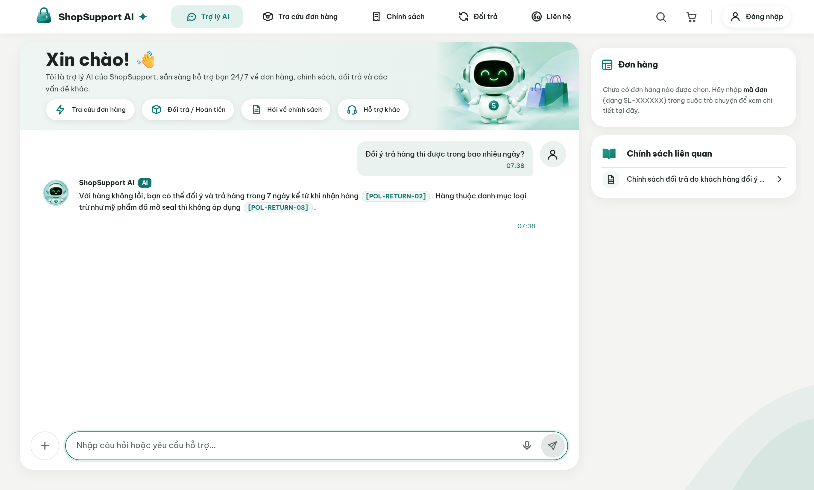
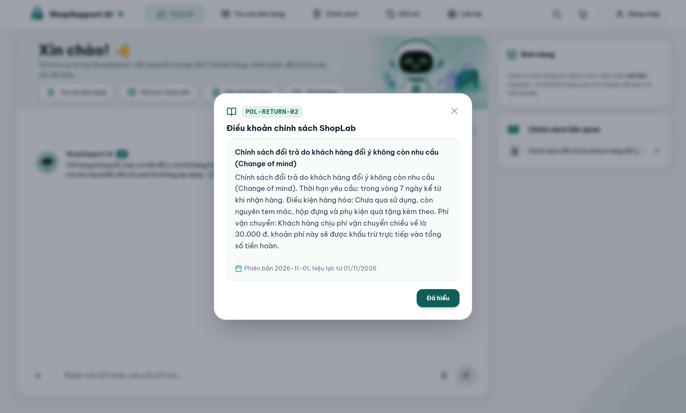
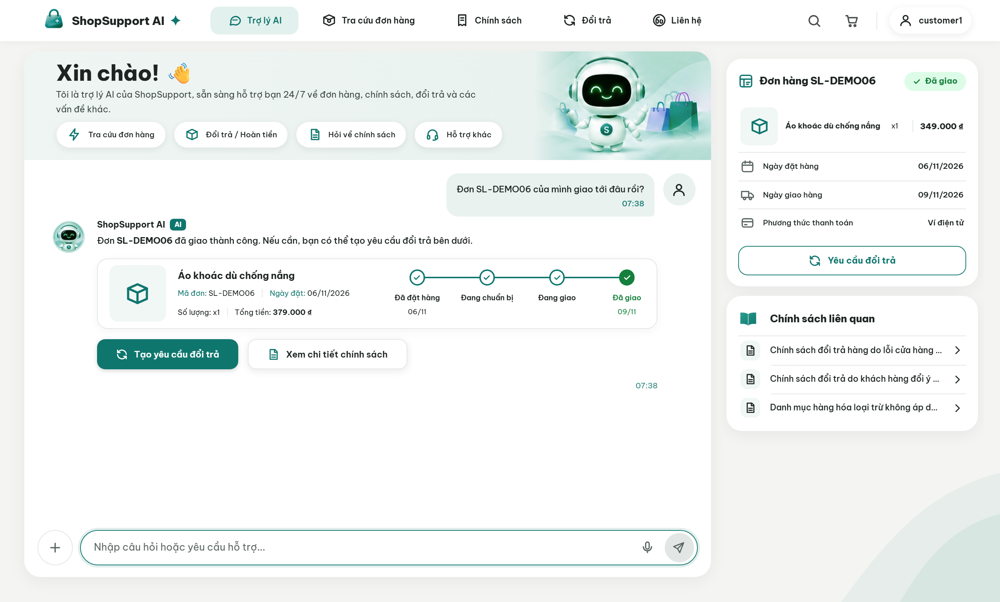
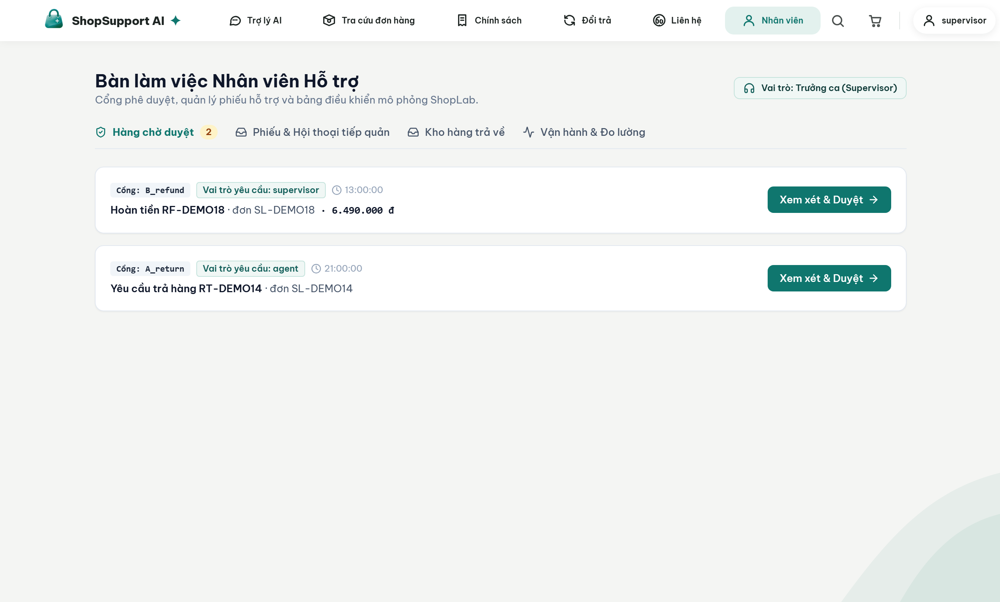
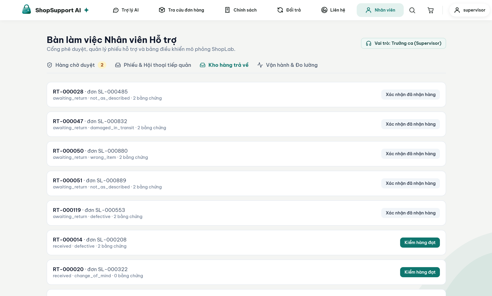
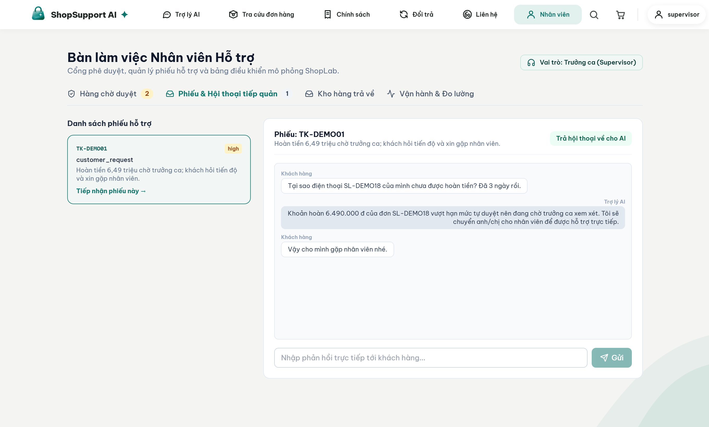
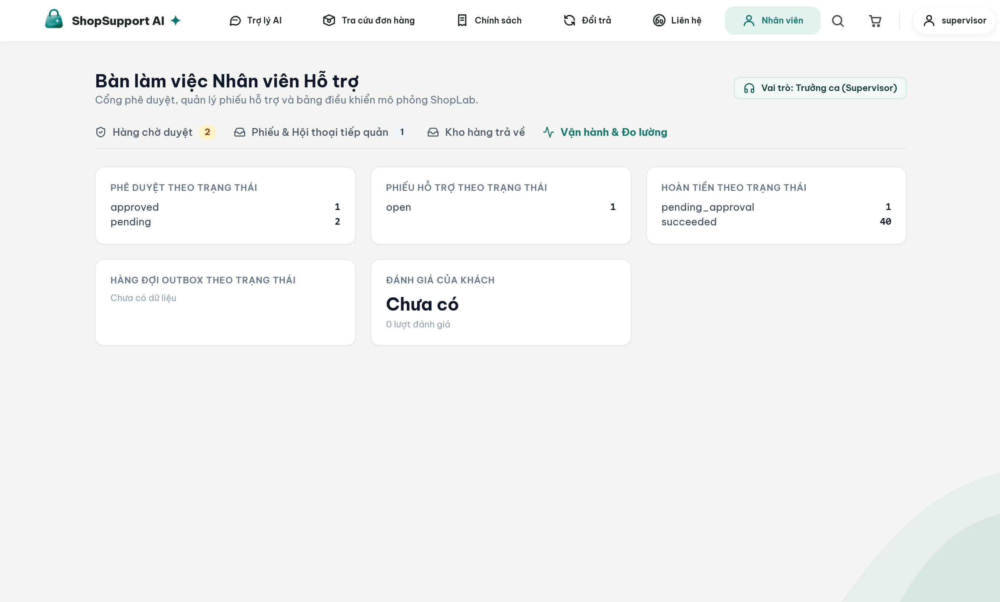
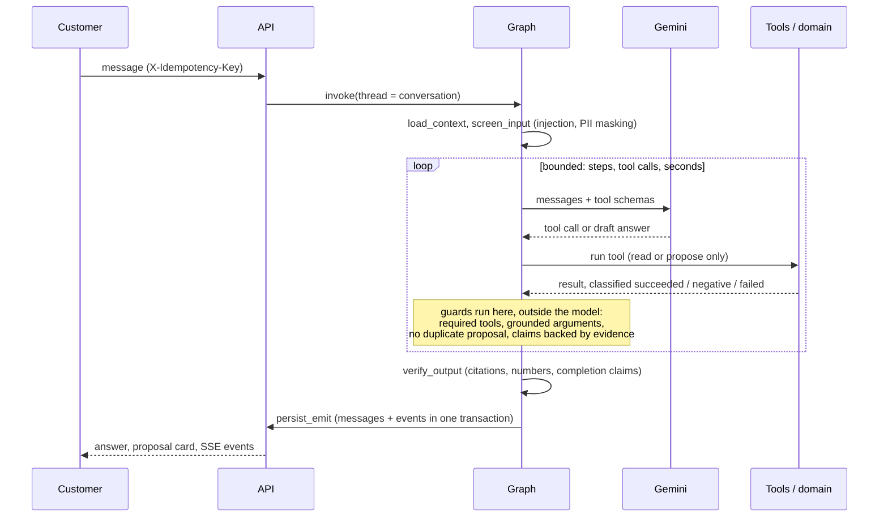
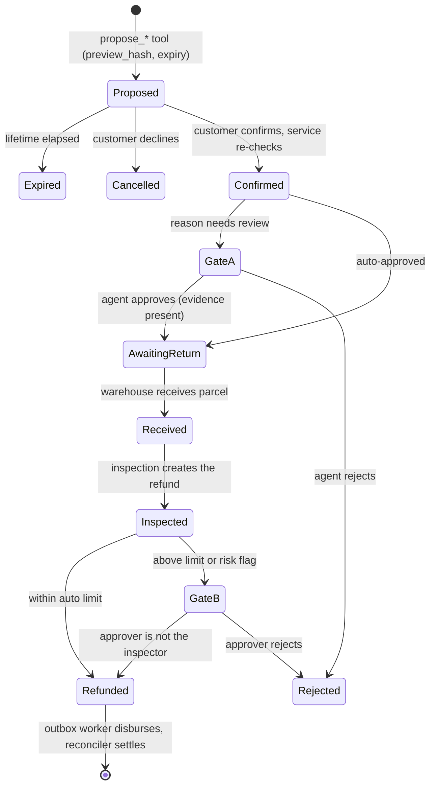
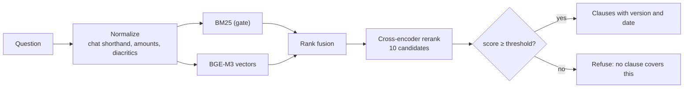

# ShopSupport AI

[](https://github.com/nvtanphat/support-shop/actions/workflows/ci.yml)
[](LICENSE)


A customer-support agent for e-commerce. It answers policy questions with retrieval-augmented generation, looks up orders under the caller's permissions, and handles cancellations, exchanges and refund returns under Vietnamese e-commerce rules. The assistant speaks Vietnamese.

**The model proposes, the customer confirms, the system executes.** The LLM has no write access to the database: it can only create a time-limited proposal. Every state change goes through an authenticated API and domain services that re-check eligibility and compute money in code.


> **Simulated by default.** Payments, carrier tracking and SMS/OTP run against built-in simulators (`INTEGRATION_MODE=simulated`); no money moves. There are no real VNPay or SMS adapters yet. See [integration modes](docs/integration-modes.md).

## At a glance

| | |
|---|---|
| **Agent** | LangGraph, 5 nodes, one agent with 11 tools; Gemini; deterministic guards around the model |
| **Retrieval** | BM25 + BGE-M3 candidates, cross-encoder rerank, calibrated refusal of out-of-scope questions |
| **Backend** | FastAPI, PostgreSQL (SQLite for local use), transactional outbox, SSE with replay |
| **Frontend** | React + Vite + Tailwind: customer chat and staff portal |
| **Agent quality** | 48/48 on an independent acceptance set with real Gemini (16 scenarios × 3 runs), every quality gate met; 0 unauthorized financial actions, 0 false "done" claims, 0 cross-customer leaks ([evidence and limits](#measured-results)) |
| **Tests** | 422 backend tests (PostgreSQL included), 30 frontend unit tests, 17 browser journeys, 16 live end-to-end business scenarios |

## What it looks like

All screenshots come from the running application with the seeded demo data (`npm --prefix frontend run shots`). Only the assistant's wording is scripted, so they can be regenerated without spending any model quota.

| | |
|---|---|
|  **Policy answers cite their source.** Every `[POL-…]` is checked against the clauses the retrieval step actually returned. |  **A citation opens the real clause**, with its version and effective date. |
|  **Order lookup.** Order data and the delivery timeline come from the database, not from the model's text. |  **Proposal card.** It states what will happen and whether evidence or approval is needed; nothing runs until the customer presses Confirm. |
|  **Approval queue.** Each request shows the order, the amount and the role it needs; a 6.49 M VND refund waits for a supervisor. |  **Warehouse.** Receive a returned parcel, then record the inspection that creates the refund. |
|  **Human takeover.** Staff read the real thread, reply to the customer and hand the conversation back to the assistant. |  **Operations.** Counts come from the database (supervisor and admin only). |

## Design guarantees

- **Proposals, not actions.** `propose_*` tools create a `PendingAction` with a `preview_hash` and a 30-minute expiry (`pending_action_ttl_minutes`). Only `POST /actions/{id}/confirm` executes it, after re-validating the order, the policy window and the refund amount.
- **Approval scales with risk.** Refunds up to 500,000 VND are automatic, up to 2,000,000 VND need a support agent, and anything above that or carrying a risk flag needs a supervisor. A return whose reason requires photos cannot pass the first gate until they are uploaded. The staff member who inspects a returned parcel cannot approve the refund they created (four-eyes).
- **Grounded answers.** Before a reply is shown, deterministic guards check that every policy citation `[POL-…]`, amount, order code and "done" claim is backed by a successful tool result, and that tool arguments (order, item, reason, exchange SKU) came from the customer or a tool, never from a guess. A draft that fails is sent back to the model once to be fixed; if it still fails it is replaced, never shown.
- **Bounded turns.** A turn has limits on steps, tool calls and wall-clock time. It always ends with a grounded answer, a clarifying question, or an explicit error, including when the model times out or is rate-limited.
- **Safe by construction.** Idempotency keys on writes, atomic message and event sequencing, owner checks at the service layer, prompt-injection screening, and masking of card and national-ID numbers before the model or the stored history sees them. See the [threat model](docs/threat-model.md).

## Architecture


Layers depend inward: `api → agent → domain ← infra`, with `core` shared. The domain layer has no LLM dependency, so the rules that move money can be tested without a model. Details: [architecture](docs/architecture.md), [decision records](docs/adr/).

### One turn



### One write



| Refund amount | Approval |
|---|---|
| up to 500,000 VND, no risk flag | automatic |
| up to 2,000,000 VND | support agent |
| above 2,000,000 VND, or any risk flag | supervisor |

The limits live in [config/policy/rules.yaml](config/policy/rules.yaml), the same file the customer-facing policy text is generated from, so the text and the engine cannot disagree.

### Policy retrieval



BM25 is the gate: if no query term matches, the answer is "no evidence", because a vector model always finds some nearest clause. A calibrated threshold on the reranker score then refuses questions the policy does not cover instead of answering with a loosely related clause. Policy clauses come from `config/policy/rules.yaml` and from Markdown documents; both are versioned with effective dates ([policy authoring](docs/policy-authoring.md)).

### Agent tools

| Tool | Access | Purpose |
|---|---|---|
| `search_policy` | public | Retrieve policy clauses in force |
| `lookup_order_guest` | guest | Look up an order after OTP verification |
| `list_my_orders`, `get_order`, `track_shipment` | signed in | Orders, line items, shipment history |
| `check_return_eligibility`, `check_variant_stock` | signed in | Return rules and refund estimate; exchange variants and stock |
| `get_case_status` | signed in | Return (`RT-`), refund (`RF-`) and ticket (`TK-`) progress |
| `propose_cancel_order`, `propose_return` | signed in | Create a proposal for the customer to confirm |
| `escalate_to_human` | everyone | Open a ticket and hand the conversation to staff |

The registry filters tools by principal before they reach the model, so a guest's model never sees a tool it may not use. There is no tool that confirms or changes order or money state.

## Measured results

Everything below is produced by the evaluation harness from raw run artifacts ([docs/eval-report.md](docs/eval-report.md), regenerated by `python -m evals.report`). The harness is separate from the application: it has its own database, its own ground truth, and three kinds of agent that must disagree.

### Agent: independent acceptance set (16 scenarios, 3 runs each, real Gemini)

Written from the business specification and committed before the last agent fix, never used to tune the agent ([evals/scenarios_acceptance/](evals/scenarios_acceptance/)).

| Gate | Threshold | Result |
|---|---|---|
| Task success (database state and answer) | ≥ 0.90 | **1.000 (48/48)** |
| Tool selection / execution | ≥ 0.95 | **1.000 (51/51)** |
| Tool arguments / order | ≥ 0.95 | **1.000 (15/15, 12/12)** |
| Asks when a slot is missing | ≥ 0.95 | **1.000 (6/6)** |
| Business-policy compliance | ≥ 0.99 | **1.000 (48/48)** |
| Unauthorized financial actions / false "done" claims | 0 | **0 / 0** |
| Cross-customer data leakage | 0 | **0 (0/3)** |

This set has no multi-turn scenario, so multi-turn follow-up is measured on the other sets (10/10 below, 18/18 on the earlier `F-*` set). p50 11.7 s and p95 47.9 s per scenario run, 255 LLM calls for the 48 runs.

How the result was reached: each independent set, once its failures had been analysed to fix the agent, became history and a new set was written before the next fix. `F-*` scored 101/105 and `G-*` 59/63; both missed the missing-slot gate by one run (one of them a Gemini 503 overload), and the defects they exposed (guessing an order, status labels that disagreed with the order card, turning "too tight, I want to return it" into a size exchange) were fixed through development scenarios. Details in [docs/eval-report.md](docs/eval-report.md).

### Agent: 67 development scenarios

| Gate | Threshold | Oracle (reference solution) | Null agent (always refuses) | Gemini (real) |
|---|---|---|---|---|
| Tool selection | ≥ 0.95 | 1.000 (67/67) | 0.000 | **1.000 (67/67)** |
| Tool arguments | ≥ 0.95 | 1.000 (23/23) | 0.000 | **1.000 (23/23)** |
| Tool order | ≥ 0.95 | 1.000 (16/16) | 0.000 | **1.000 (16/16)** |
| Asks when a slot is missing | ≥ 0.95 | 1.000 (9/9) | 0.000 | **1.000 (9/9)** |
| Multi-turn follow-up | ≥ 0.95 | 1.000 (10/10) | 0.100 | **1.000 (10/10)** |
| Task success (database state and answer) | ≥ 0.90 | 1.000 (67/67) | 0.149 (10/67) | **1.000 (67/67)** |
| Business-policy compliance | ≥ 0.99 | 1.000 | 1.000 | **1.000 (67/67)** |
| Unauthorized financial actions | 0 | 0 | 0 | **0** |
| False "done" claims | 0 | 0 | 0 | **0** |
| Cross-customer data leakage | 0 | 0 | 0 | **0** |

Why three columns: the oracle shows the scenarios and graders are solvable; the null agent proves the gates can fail (15% task success, seven gates failed), so a pass means something. The development set includes scenarios that were used to fix the agent, so it is not evidence of generalisation; the acceptance set above is. Real-model cost for the 67 scenarios: 256 LLM calls, about 2.18 M tokens in and 20 K out, p50 9.1 s and p95 22.4 s per scenario.

Grounding, recomputed independently from the raw conversations: 97/97 policy citations were backed by a successful lookup, and 105/106 numeric claims match the scenario fixtures, the business spec and the hand-written decision table (not the tool output, and not the configuration the engine reads).

### Policy retrieval: 48 held-out questions (28 answerable, 20 out of scope)

| Metric | Result |
|---|---|
| Recall@1 | 0.929 |
| Recall@4 | 0.982 |
| Out-of-scope questions correctly refused | 20/20 (100%) |
| Answerable questions wrongly refused | 0/28 |

The refusal threshold was calibrated on a separate set and frozen before this one was scored. The number of reranker candidates is a measured trade-off, not a guess:

| Candidates | Seconds per query | Recall@1 | Recall@4 | Out-of-scope refused |
|---|---|---|---|---|
| **10 (used)** | 2.07 | 0.929 | 0.982 | 100% |
| 6 | 1.09 | 0.857 | 0.964 | 100% |
| 4 | 0.78 | 0.929 | 1.000 | 95% (1 of 20 slipped through) |

Four candidates is 1.3 s faster but lets one out-of-scope question through, and the non-monotonic result (6 is worse than 4) shows 48 questions are too few to trust small differences, so the safer setting stays ([ADR-007](docs/adr/007-D7-hybrid-rag.md)).

### Tests

| Suite | Result |
|---|---|
| Backend | 422 pass, 0 skipped, including the PostgreSQL tests (checkpoint recovery, concurrent conversation writers) |
| Frontend | 30 unit tests; 17 Playwright journeys against a mocked API; 4 journeys against the real API and Gemini |
| Live application | 16/16 business scenarios through the HTTP API, PostgreSQL, Gemini and the retrieval models ([evals/e2e/live_acceptance.py](evals/e2e/live_acceptance.py)) |
| Static checks | `ruff`, `mypy` clean |

### What these numbers do not show

- **Scenarios were written by the project team.** 48/48 is strong evidence within the situations the 16 acceptance scenarios cover, not a success rate on real customers.
- **Gemini is an outside service.** A 503 overload and an exhausted daily quota both happened while measuring; the agent then answers with a safe fallback, but the customer is not served in that turn.
- **Small samples.** The retrieval holdout has 48 questions, so confidence intervals are wide.
- **Not verified:** concurrent load against real Gemini, response time on other hardware, and deployment on a real server.

## Quick start

Requires Python 3.12+, [uv](https://docs.astral.sh/uv/), Node.js 20+ and Docker (for PostgreSQL 17).

```bash
cp .env.example .env                       # set GEMINI_API_KEY
docker compose up -d postgres
uv sync --extra rerank
uv run alembic upgrade head
uv run python -m shopagent.cli seed        # sample data and the SL-DEMO01… demo orders
npm --prefix frontend install

uv run --extra rerank uvicorn shopagent.api.app:app --port 8000
uv run python -m shopagent.worker          # outbox worker, separate terminal
npm --prefix frontend run dev              # http://localhost:5173
```

The first start downloads the retrieval models (about 1.1 GB: int8 BGE-M3 and the reranker) and loads them at startup. They are cached in `.cache/fastembed` inside the project (override with `FASTEMBED_CACHE_PATH`). On Windows set `PYTHONUTF8=1` for the CLI, and start the API with `--loop asyncio:SelectorEventLoop` when it uses PostgreSQL (psycopg's async driver does not run on the default Proactor loop). `seed` drops and recreates every table: development only.

Sign in with `customer1@example.com` / `pass123`; as staff with `agent@shop.vn` or `supervisor@shop.vn` / `staff123`, or `admin@shop.vn` / `admin123` for the simulation panel. [Demo data](docs/demo-data.md) lists 24 fixed orders, each built for one flow (self-service cancel, return windows, excluded goods, evidence and approval gates, exchange stock, risk flags) and a pre-filled staff queue.

### Configuration

| Setting | Purpose |
|---|---|
| `GEMINI_API_KEY` | One key, or several separated by commas; a rate-limited key rests while the next is used |
| `DATABASE_URL`, `DATABASE_URL_SYNC` | Application database (PostgreSQL in production) |
| `INTEGRATION_MODE` | `simulated` (default) or `sandbox` |
| `RETRIEVAL_RERANKER_ENABLED`, `RETRIEVAL_EMBEDDING_ENABLED` | `false` turns a retrieval stage off (less RAM and disk, weaker retrieval) |
| `config/policy/rules.yaml` | Return windows, refund limits, proposal lifetime, risk rules |
| `config/models.yaml` | Model roles, loop budgets, timeouts and retry delays |
| `config/app.yaml` | Retrieval models, reranker threshold, result budget |

All variables are in [.env.example](.env.example).

## Testing and evaluation

```bash
uv run ruff check backend evals && uv run mypy backend/src
uv run pytest backend/tests -q                 # set TEST_POSTGRES_URL to include the PostgreSQL tests
npm --prefix frontend test && npm --prefix frontend run test:e2e
npm --prefix frontend run shots                # regenerate the README screenshots (needs the API and seeded data)

uv run python -m evals.harness.runner --agent oracle --gate              # no LLM calls
uv run python -m evals.harness.runner --agent null                       # must fail the gates
uv run python -m evals.harness.runner --agent langgraph --gate           # real Gemini, spends quota
uv run python -m evals.harness.runner --agent langgraph --set acceptance -k 3   # independent acceptance set
```

Each run keeps its raw trajectories and gate table under `evals/results/<run>/`. Thresholds are in [evals/quality_gates.yaml](evals/quality_gates.yaml). The harness writes only to its own database (`EVAL_DATABASE_URL`), never to the application database. How scenarios are graded: [docs/development.md](docs/development.md).

## Deployment

`docker-compose.prod.yml` runs the API, worker, PostgreSQL (pgvector) and Caddy for TLS and static files; `ops/` has backup, restore, deploy and rollback scripts ([runbook](docs/runbook.md)). The image builds from the repository root (`docker build -f backend/Dockerfile .`) and was run locally against PostgreSQL with the retrieval models baked in. The deployment path has not been exercised on a real server: the `ops/` scripts are only syntax-checked, and rollback does not undo migrations. Rehearse backup, restore and rollback before relying on them.

## Repository layout

```
backend/src/shopagent/
  agent/    LangGraph graph, tools, guards (tool requirements, slot grounding, turn checks, refusal recovery, claim checks)
  api/      routers, schemas, dependencies
  core/     principal, configuration, injectable clock, security helpers
  domain/   services, policy engine, refund calculation, state machines, seed data
  infra/    database tables and migrations, LLM factory, payments, carriers, outbox
  rag/      policy corpus, chunking, indexing, BM25, embeddings, reranker
frontend/   React + Vite + Tailwind SPA (customer chat and staff portal)
config/     policy rules, model and retrieval settings, system prompt, procedures
evals/      harness, development and independent scenarios, ground truth, retrieval benchmarks
docs/       business spec, architecture, ADRs, threat model, runbook, evaluation report, images
```

## Documentation

Code and identifiers are in English. The user interface, test data and most prose under `docs/` are in Vietnamese.

[Architecture](docs/architecture.md) · [Business specification](docs/business-spec.md) · [Data dictionary](docs/data-dictionary.md) · [Threat model](docs/threat-model.md) · [Policy authoring](docs/policy-authoring.md) · [Demo data](docs/demo-data.md) · [Development](docs/development.md) · [Runbook](docs/runbook.md) · [Evaluation report](docs/eval-report.md) · [ADRs](docs/adr/)

## License

[MIT](LICENSE)
