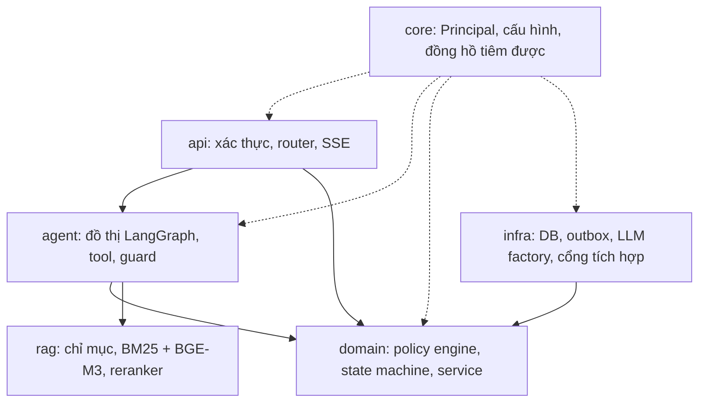

# Kiến trúc

Chi tiết quyết định ở [docs/adr/](adr/). Tài liệu này chỉ mô tả cấu trúc hiện có.

## Tầng và quy tắc phụ thuộc

```
api  ->  agent  ->  domain  <-  infra
              \--->  rag
core: được mọi tầng dùng (Principal, cấu hình, đồng hồ, bảo mật)
```

- `domain/` chứa nghiệp vụ thuần (policy engine, tính tiền hoàn, state machine, service) và không phụ thuộc framework LLM.
- `infra/` cài đặt các cổng (DB, thanh toán, vận chuyển, outbox, LLM).
- `agent/` là đồ thị LangGraph; tool chỉ đọc hoặc tạo đề xuất, không ghi trạng thái đơn hay tiền.
- `api/` xác thực, phân quyền ở tầng service, SSE.

## Một lượt hội thoại

`load_context` -> `screen_input` -> `agent` (vòng gọi tool có hạn mức) -> `verify_output` -> `persist_emit`. Văn bản của trợ lý chỉ được phát sau `verify_output`.

`load_context` đọc lại từ cơ sở dữ liệu mỗi lượt: đơn gần đây, thẻ đang chờ, thẻ khách đã xác nhận và phiếu hỗ trợ đang mở, nên agent biết những gì đã xảy ra qua API chứ không chỉ qua công cụ.

Trong node `agent`, các guard xác định chạy ngoài LLM:

- `tool_requirements`: tool bắt buộc theo câu của khách (mã đơn thì phải tra đơn, câu hỏi chính sách thì phải tra chính sách), và sau một lời từ chối nghiệp vụ thì phải có điều khoản.
- `slot_guard`: mỗi tham số của một lần gọi tool phải có căn cứ: đơn do khách chọn, sản phẩm lấy từ `get_order`, lý do khách nói hoặc trích nguyên văn (`reason_quote`), đổi hàng chỉ khi khách xin đổi, SKU đổi lấy từ `check_variant_stock`.
- `turn_checks`: nhìn cả lượt: thông tin bị báo thiếu hai lần hoặc lời từ chối lặp lại thì tắt tool và hỏi khách; bản nháp phải hỏi khách khi còn thiếu thông tin, và phải hỏi khách chọn đơn thay vì đoán.
- `recovery`: gắn `next_step` cho mỗi lời từ chối đã biết, để model giải thích và đưa hướng thay thế.
- `proposal_guard`: không tạo đề xuất trùng.
- `grounding` (dùng cả trong `verify_output`): số tiền, mã đơn, trích dẫn và mọi tuyên bố "đã xong" phải có bằng chứng từ tool thành công hoặc từ thẻ khách đã xác nhận.

Trạng thái lượt: `completed`, `synthesized`, `requirements_unmet`, `degraded`. Xem [ADR 022](adr/022-D22-agent-turn-control.md).

## Vòng đời một hành động ghi

1. Tool `propose_*` tạo `PendingAction` kèm `preview_hash`; thời hạn lấy từ `pending_action_ttl_minutes` trong `config/policy/rules.yaml`.
2. Khách gọi `POST /actions/{id}/confirm` với `preview_hash`; service kiểm tra lại điều kiện và tính tiền.
3. Cần duyệt (hoàn từ 500.000 đ hoặc rủi ro cao) thì tạo `ApprovalRequest`; nhân viên quyết định qua `/staff/approvals/{id}/decision`.
4. Sự kiện được ghi vào `outbox_events` cùng giao dịch; worker giải ngân và `PaymentReconciler` đối soát các khoản kẹt.

## Dữ liệu và trạng thái

- Cột, khóa và ràng buộc: [data-dictionary.md](data-dictionary.md).
- Tin nhắn và sự kiện SSE có `seq` cấp phát nguyên tử; client kết nối lại bằng `Last-Event-ID`.
- Checkpoint hội thoại: `AsyncPostgresSaver` trên PostgreSQL, SQLite bền cho chạy cục bộ.
- Phân quyền theo chủ sở hữu kiểm ở tầng service và có test cho từng điểm cuối. Chưa dùng row-level security của PostgreSQL.

## Chính sách và RAG

Nguồn duy nhất là `config/policy/rules.yaml`; `rag/generator.py` sinh văn bản, `index-policies` lập chỉ mục. BM25, chuẩn hóa câu hỏi, khôi phục dấu, reranker tùy chọn, ngưỡng từ chối.

## Phụ thuộc giữa các tầng



`domain/` không phụ thuộc framework LLM; `infra/` cài đặt các cổng mà domain định nghĩa. Tool trong `agent/` chỉ đọc hoặc tạo đề xuất.

## Vòng đời một hành động ghi

```mermaid
sequenceDiagram
    autonumber
    actor K as Khách hàng
    participant A as Agent (LLM)
    participant S as Domain service
    participant DB as PostgreSQL
    participant W as Worker
    actor N as Nhân viên

    K->>A: "Tôi muốn trả hàng SL-..."
    A->>S: propose_return (chỉ tạo đề xuất)
    S->>DB: PendingAction + preview_hash + hạn
    A-->>K: ActionCard (chưa có gì bị thay đổi)
    K->>S: POST /actions/{id}/confirm (preview_hash)
    S->>S: kiểm tra lại điều kiện, tính tiền bằng code
    alt cần duyệt (cổng A hoặc B)
        S->>DB: ApprovalRequest
        N->>S: /staff/approvals/{id}/decision (bắt buộc ghi chú)
    end
    S->>DB: đổi trạng thái + outbox_events (cùng một giao dịch)
    DB-->>W: sự kiện outbox
    W->>W: giải ngân; PaymentReconciler đối soát khoản kẹt
```

Số thứ tự tin nhắn và sự kiện SSE cấp phát nguyên tử bằng khóa bi quan trên PostgreSQL; client gửi `X-Idempotency-Key` để khử trùng lặp, kết nối lại bằng `Last-Event-ID`.

## Tìm kiếm chính sách (chi tiết)

Hai bước. Bước lấy ứng viên là hybrid: BM25 trên điều khoản (câu hỏi đã chuẩn hóa viết tắt, số tiền) gộp theo hạng (RRF) với độ tương đồng của vector `BAAI/bge-m3` (câu hỏi đã khôi phục dấu). BM25 vẫn là cổng: không từ nào khớp thì trả "không có bằng chứng", vì mô hình vector luôn tìm ra một điều khoản gần nhất kể cả với câu hỏi về thời tiết. Bước hai là cross-encoder `BAAI/bge-reranker-v2-m3-int8` xếp hạng lại. Tắt embedding (`RETRIEVAL_EMBEDDING_ENABLED=false`) thì bước một chỉ còn BM25. Câu hỏi có điểm dưới ngưỡng `retrieval.reranker.min_score` trong [config/app.yaml](../config/app.yaml) bị từ chối thay vì trả điều khoản gần đúng.

## 11 công cụ nghiệp vụ

| Tool | Quyền | Mô tả |
|---|---|---|
| `search_policy` | Công khai | Tra cứu điều khoản chính sách |
| `lookup_order_guest` | Khách vãng lai | Tra cứu đơn sau khi xác thực OTP |
| `list_my_orders` | Đăng nhập | Danh sách đơn gần đây |
| `get_order` | Đăng nhập | Chi tiết đơn, thanh toán, vận chuyển |
| `track_shipment` | Đăng nhập | Lịch sử vận chuyển |
| `check_return_eligibility` | Đăng nhập | Điều kiện đổi trả và số tiền hoàn |
| `check_variant_stock` | Đăng nhập | Tồn kho SKU muốn đổi |
| `get_case_status` | Đăng nhập | Tiến độ hồ sơ `RT-`, `RF-`, `TK-` |
| `propose_cancel_order` | Đăng nhập | Đề xuất hủy đơn |
| `propose_return` | Đăng nhập | Đề xuất đổi hoặc trả hàng |
| `escalate_to_human` | Mọi người | Chuyển nhân viên khi có tranh chấp |

## Cấu trúc thư mục

```
backend/src/shopagent/
  agent/    đồ thị LangGraph, tool, guard (tool_requirements, slot_guard, turn_checks, recovery, grounding), checkpoint
  api/      router, schema, dependency, health
  core/     Principal, cấu hình, đồng hồ tiêm được
  domain/   nghiệp vụ, policy engine, tính tiền hoàn
  infra/    bảng DB, migration, LLM factory, outbox
  rag/      chunking, index, BM25, embedding BGE-M3, khôi phục dấu, reranker
backend/tests/   unit, api, integration
frontend/src/    app, features/chat, features/staff, components, lib, styles
config/          app.yaml, models.yaml, policy, prompt hệ thống
docs/            spec nghiệp vụ, runbook, threat model, ADR, báo cáo đánh giá, design/
evals/           harness, 44 kịch bản, bộ truy vấn chính sách, báo cáo
```

## Mở rộng kho chính sách

Hai nguồn (điều khoản sinh từ `rules.yaml` và tài liệu Markdown), kiểm tra chung, lập chỉ mục tăng dần theo băm nội dung, chunk có `source`, `title`, `parent_id`, `status`. Retriever gồm nguồn ứng viên thay được (`CandidateSource`) và reranker. Cách viết, kiểm tra và hiệu chỉnh ngưỡng: [policy-authoring.md](policy-authoring.md).
